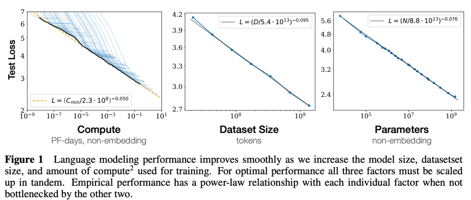

 ### Scaling Laws for Neural Language Models (Kaplan et al., 2020)
 원문(arXiv): https://arxiv.org/abs/2001.08361
 
- transformer 구조를 바꾸자?
- attention을 수정하자?
- layer를 다르게 쌓자? 

구조를 찾는게 핵심으로 생각했지만, 그냥 큰 모델을 구성해두는게 답이라는걸 발견 

#### 발견들 




GPU 시간(epoch를 많이하는것)을 늘려도

Loss ∝ C^-γ

- 같은 모델이라면 gpu를 오래 돌릴수록 loss 줄어든다. 


모델 크기 (parameter 수 N)가 커질수록 

Loss ∝ N^-α


데이터 양 D를 늘려도

Loss ∝ D^-β


#### 결론

큰 모델 만들고, 모든 데이터를 여러번 반복학습 시키지 않아도 된다. 

- 모델 크기를 더 키우고
- 학습 시간은 덜 투자해라 (epoch는 줄여라)

샘플링 해보니 큰 모델이 덜 배웠는데도 더 똑똑하더라

```
★★★★★ 모델 크기

★★ 데이터

★ 학습 시간
```

이렇게 분배하라고 제안. (175B에 300B token으로 학습시키기 정도)

반면, 추후 구글 DeepMind는 배울게 많은데 데이터가 끝났음을 발견. 70B모델에 1.4T token을 녹이니 

모델 크기가 더 작은 (175B > 70B) Chinchilla가 더 잘하더라. Chinchilla scaling law를 확인함 

학습 토큰 수(Token)는 모델 파라미터 수의 약 20배 정도가 계산 효율 측면에서 적절하다는 것입니다.

- 모델이 단순히 커지기 보다는, 학습 토큰 개수에 달려있는셈. 

다만, Claude 4, GPT-5 시대부터는 인터넷의 고품질 텍스트가 거의 고갈되었기 때문에, 단순한 scaling으로는 더 좋은 성과가 나지않음. 


대신, post-training, inference 때 생각많이하게 하기 (inference-time-scaling), synthetic data (기존 AI가 만든 문제를 새 AI가 풀고 좋은 답만 다시 학습)학습

### 부연설명

post-training은

```
Pretraining

↓

SFT

↓

RLHF / RLAIF

↓

Reasoning Training

↓

Tool Use
```


pretraining은 다음 단어 맞추기 위주 (next-token-prediction)

SFT (Supervised Fine-Tuning)
- 사람처럼 대답하는 방법 
- 질문을 받았을 때 좋은 답변 학습데이터로, LLM이 이걸 따라하게 해. 

--- 

RLHF / RLAIF 
- 사랍이 답변을 평가해서 AI를 더 똑똑하게 만든다. 
- claude가 GPT 답 평가, GPT가 claude 답 평가 등 AI끼리 돌리는게 더 싸고 빠르다 

Reasoning Training
- 요즘 가장 뜨거운 분야인데, 답만 맞추는게 아니라 생각하는 방법을 배우자는 것 

127 x 53같은걸 외워서 맞추는게 아니라, reasoning model은 

```
127 × 50

+

127 × 3

=

6350 + 381
```

이런 중간과정을 만들어가면서 풀게 학습함. (질문 -> 생각 -> 답) 하게 하는 것. 

thinking 모델들의 성능향상 


---

Tool use : 외부도구 호출, 결과 활용


## predictability and surprise in large generative models 

https://www.anthropic.com/research/predictability-and-surprise-in-large-generative-models

