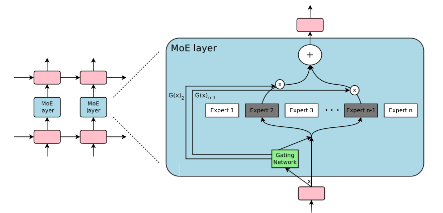
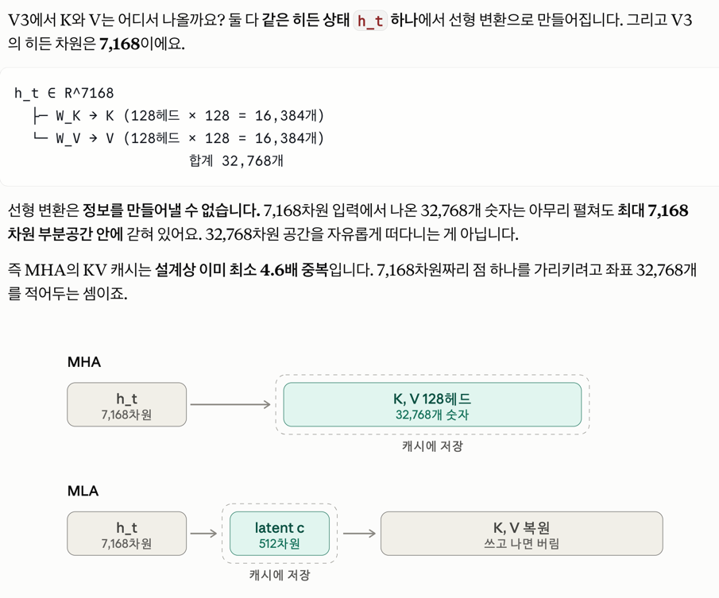

## 이전시간엔 


Scaling Laws for Neural Language Models (Kaplan et al., 2020)

원문(arXiv): https://arxiv.org/abs/2001.08361

지난번에 공부한 바 대로라면 모델크기가 커야 충분히 많은 양의 학습 토큰을 습득할 수 있다고 말했는데

자원을 분배한다고 했을 때, 최소 이정도의 학습 토큰을 제공해야한다는 것을 의미한다고 한다. 

아무튼 근데 deepseek는 왜 저렴한 가격으로, 굳이 큰 모델 쓰지 않아도 된다고 한걸까? 

## deepseek v3 설명 


V3는 총 671B 파라미터 중 토큰당 37B만 활성화되고, 14.8T 토큰으로 사전학습됐어요. 계산해보면

- 활성 파라미터 기준: 14.8T / 37B ≈ 400배
- 전체 파라미터 기준: 14.8T / 671B ≈ 22배 — Chinchilla와 거의 일치

즉, inference할 때 활성되는 파라미터가 적으니, gpt-4o랑 비슷한 시간에, 더 저렴한 비용으로 inference했다는 것이었다.


Mixture Of Experts (MoE)
- 학습·추론 연산량은 활성 파라미터에 비례하고, 지식 저장 용량은 전체 파라미터에 비례해요. 둘을 분리하면 37B 모델의 비용으로 671B 모델의 용량에 맞는 토큰 예산을 소화할 수 있습니다
- 활성화 비율이 5.5% (8개 전문가만 사용됨 256개 전문가중) 전체 학습에 훨씬 적은 시간이 소요됨. 

deep seek 가 좋은 모델을 낸 이유

- RLHF 쓰면되는구나 이미 알고 시작함 
- MoE로 연산/용량 분리, MLA로 KV 캐시 압축, FP8 혼합정밀도. 
- H800 - 수출규제당해서 H100과 연산량은 같은데 네트워크 대역폭이 낮음. 
  - 연산과 통신을 겹치는 DualPipe 파이프라인 병렬화 
  - 노드간 라우팅 범위를 제한해 트래픽을 묶는 node-limited routing
  - CUDA를 건너뛴 PTX 어셈블리 레벨 커널 최적화 
- 최종 학습비용이 600만 달러라고 했는데, 연구개발비 토탈이 아니라, 최종 프리트레이닝 런 한번 할때의 GPU 비용. 프론티어 랩들도 GPU만으로 측정하면 비용 확 줄어듦. 

## Transformer 기본 구조 설명  

```
x
↓
Multi-Head Self-Attention
↓
Add & Norm
↓
Feed Forward Network (FFN)
↓
Add & Norm
↓
출력
```

attention은 각 모든 input token이 output 토큰에 상호 영향주는 레이어. 


Multi-Head Attention

- "attention 여러 개"라는 건 여러 head가 있다는 뜻이야.
- 각 head는 서로 다른 관점을 본다.
  - head 1: 문법 관계
  - head 2: 장거리 의존성
  - head 3: 위치 패턴


FFN을 해야하는 이유는 각 head에서 나온 정보를 섞는것. 

## Mixture Of Experts (MoE)

기존 attention들이 FFN 하나로만 들어갔으면, 

```
Attention
   ↓
router 
   ↓
┌─────────┐
│ Expert 1│
│ Expert 2│
│ Expert 3│
│ ...     │
│Expert256│
└─────────┘
```

특정 토큰이 활성화시키는건 선택된 소수의 expert. (Top-K) 

deepseek는 fine-grained export 써서 expert1 -> expert1_a,expert1_b,expert1_c 해서 더 작은단위로 쪼갬. 

그러면 학습할때도 적은 양만 활성화, inference할때도 적은 양만 활성화 




## MLA 
deep seek가 잘한 부분은 MLA 하지만 defacto가 되진 못했다. 구현이 복잡해서. 

LLM이 100번째 토큰 생성할때 어텐션은 앞선 1~99번 토큰의 key value가 필요하다. 매 스텝마다 재계산할 수 없으니 한번 attention 진행한 값을 캐싱한다.


### 3\. KV cache가 없으면?

예를 들어 한 글자씩 생성한다고 해보자.

### 1번째 생성

```
입력: [나는]
```

계산:

```
K1, V1 생성
```

### 2번째 생성

```
입력: [나는 오늘]
```

KV cache가 없으면 모델은:

```
K1, V1 다시 계산
K2, V2 계산
```

### 3번째 생성

```
입력: [나는 오늘 밥을]
```

또:

```
K1, V1 다시 계산
K2, V2 다시 계산
K3, V3 계산
```

이렇게 되면 길이가 `n`일 때 총 계산량이 매우 비효율적이 돼.

KV 캐시로 해결가능.

### kv캐시 문제점 

문제는 크기가 너무 커진다는것. 컨텍스트가 늘어날수록 더 많은 양을 보관해야하고, 구조가 복잡해질수록 각 attention layer마다 kv 캐시를 보관하니 캐시가 커진다. 


`캐시 용량 = 2(K,V) × 층 수 × KV 헤드 수 × head_dim × 시퀀스 길이 × 배치 크기 × 바이트`

컨텍스트 길이와 배치 크기에 선형으로 비례합니다. 긴 컨텍스트에서는 이게 가중치보다 훨씬 커집니다. 구체적으로 128K 컨텍스트, 60층, 사용자 1명 기준 MHA는 KV 캐시만 약 480GB, GQA는 약 30GB, MLA는 약 7.5GB가 필요합니다

그래서, 메모리 대역폭 병목도 생긴다. HBM에서 토큰 하나 뽑을 떄마다 전체 KV 캐시를 읽어와야 해서. 


MLA는 kv 캐시 저장할때 저차원 벡터로 압축해서 저장하고, 어텐션 계산할 때 다시 벡터 복원 연산을 해서, 실제로 저장되는 kv 캐시의 크기를 줄였다. 

저차원으로 압축할 때 정보 손실이 일어날 수 있지 않냐 -> 모든 K V가 같은 임베딩 h_t 에서 나오기 때문에 실제로는 정보가 중복해서 생성됨

multi head attention이라서 생기는 문제 



그리고 effective rank 가 낮아서 대부분 0으로 채워진다 (대다수의 row가 다른 row의 선형 변환이라는 뜻)

