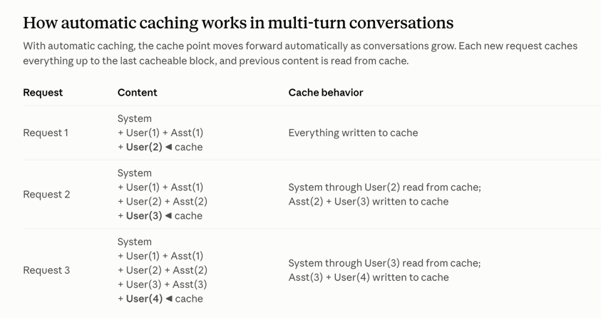
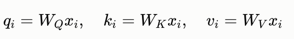
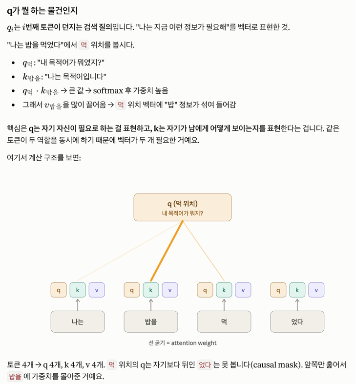
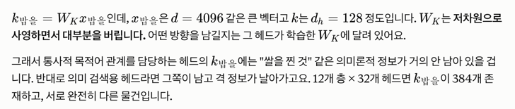
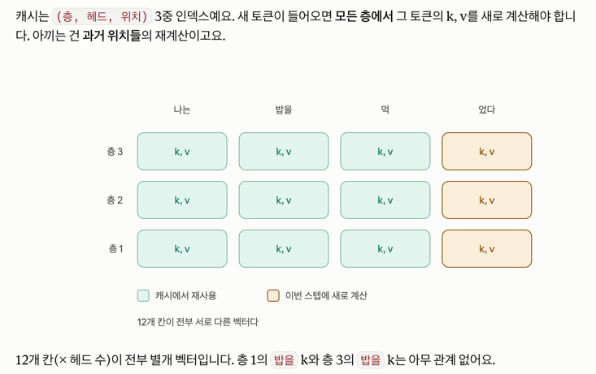

https://claude.com/blog/prompt-caching

24년 8월 

## 개괄 
Prompt Caching은 API call 할 때 자주 쓰이는 context에 대해서 cache하게 도와준다.  

90% 까지의 cost 경감, long prompt에 대해서는 85%까지의 latency 경감. 

Claude 3.5 Sonnet, Claude 3 Opus, Claude 3 Haiku 에 대해 지원된다. 


## 프롬프트 캐싱 
- 이전 request에 있던 정보를 반복적으로 참조하는 큰 prompt를 보내야 할 때 effective하다.
  - conversational agent
    - instruction이나 uploaded document
  - coding assistants
    - codebase의 summarized version을 가지고 있게 함 
  - multi round agentic search and tool use 
    - 각 step마다 api call하더라도 performance 좋음 


가격 책정 (sonnet 3.5)
- cache에 쓸 때는 3.75$/ 1M token  
- cache에서 읽을 일 있을땐 0.3% / 1M token
- 원래 input: 3$ / 1M , output: 15$ / 1M 

## 어떻게 작동한담? 

https://platform.claude.com/docs/en/build-with-claude/prompt-caching

1. prompt를 보고 특정 cache breakpoint까지 prefix를 확인해서, 최근 query에서 cache된 정보인지 확인한다. 
2. 있으면 cache버전 쓰고, 없으면 full prompt 저장해둔다. 

이런 대상에게 유용하다
- few shot 많이 제공하는 prompt
- 큰 context, background info 
- repetitive task
- long multi-turn 대화 

캐시는 5분동안만 유지되는게 디폴트. (request 시작으로부터 5분임)



이전까지의 대화를 캐싱해둘수있게함. 

## 어떻게 이걸 기술적으로 구현했을까요? 

KV (key-value) cache representations and cryptographic hashes of cached content are held in memory only

KV cache representation을 저장해둔다. 

### KV 캐시와 prompt caching

https://www.youngju.dev/blog/gpu-cuda/2026-06-26-kv-cache-and-paged-attention

https://www.edony.ink/en/the-physics-of-inference-a-deep-dive-into-kv-and-prompt-caching/

트랜스포머의 attention은 각 토큰에 대해 query, key , value 세가지 벡터를 만든다.

#### 트랜스포머 모델이 하는 일과 attention의 정의

모델 전체: 토큰 시퀀스에 대해서 다음 토큰 확률분포를 생성한다. 

어텐션 레이어: 벡터 시퀀스를 받아 벡터 시퀀스를 생성한다.
  - 각 토큰의 벡터를, 주변 토큰 정보와 섞어서 더 좋은 벡터로 업데이트한다. 
  - 이렇게 벡터 쌓기를 Layer개수만큼 쌓은다음에, 맨 마지막 층의 벡터를 unembedding해서 다음 토큰으로 생성함. 

```
입력:  나는  밥을  먹  었다
예측:   ↓     ↓    ↓    ↓
       밥을   먹   었다  .
```

그리고 모델이 학습할 때의 흐름은 이런거다. 

길이 4짜리 문장을 넣으면 예측 4개가 나온다. 모든 위치에서 동시에 예측을 만든다. 

inference할 때에도 마지막 '.' 에 대해서만 만드는게 아니라, 나머지 모두 예측하되, 다 버리고 '.' 마지막거만 출력하는거. 


#### Q, K, V 란 뭘까? 

Q,K,V는 토큰 하나마다 생성된다. 

단순히 임베딩된 토큰 == 토큰 벡터에 임의의 행렬곱을 해둔뒤, Q,K,V로 만들어둔다. 

xi 는 i번째 토큰의 벡터 



Q는 i번째 토큰이 던지는 검색 질의 == '나는 이런 정보가 필요하다'를 벡터로 표현하게 한 것. 



토큰 4개에 대해서 4개의 query가 만들어지고, 각 토큰의 key값 == 토큰의 의미

왜 Q, K, V로 나눌까? 



토큰에 대한 임베딩 벡터는 4096차원처럼 큰 벡터고, K 벡터는 128차원 처럼 저차원이다. 

각 헤드별로 역할이 있는거고 (목적어 관계 담당 헤드, 의미 검색용 헤드) Wk는 K 벡터에 어떤 정보를 남길지 학습되어있다.  

Qi도 이 헤드에서 어떤 질문을 할지 Wq가 학습이 되어있겠지? 목적어 관계 담당 헤드면 목적어를 찾아내는 질의를 뽑아내도록 할 것. 

- Q는 현재 토큰에서 생기는 질문
- K는 현재 토큰이 가지는 정보 (e.g.xxx 정보를 가지고 있다).
- V는 해당 토큰의 정보 (e.g. 나는 목적어로 쓰이는 '밥'임)

그래서, Q는 k를 통해서 해당 토큰위치의 V 벡터를 가져올지 말지를 결정하게 된다. 

```
k = "나는 이렇게 생겼다" (진술문, 남에게 검색당하기 위한 색인)
q = "나는 이런 걸 찾는다" (의문문, 검색어)
v = "누가 나를 참조하면, 나 V벡터를 줘" 
```

따라서 전체 과정은 
- Q 와 다른 K들끼리 내적해서 각 토큰들의 V벡터가 각각 얼마나 다음 레이어로 넘겨져야 할 지 확인 
- V를 각 가중치별로 합하면 다음 레이어에서 쓸 i번째 토큰에 대한 임베딩 완성 

물론, 보통은 head가 여러개니까, 이 결과물을 concat해서, 현재의 결과물에 더한다. 

`x <- x + 이번_attention_layer_결과물 * 현재레이어의 가중치 W`

이렇게 변경된 x가 다음 레이어에 들어가게 되고, 해당 레이어에서는 또 이 x에 대한 Q,K,V를 만들게 된다. 

또 `x <- x + 이번_attention_layer_결과물 * 현재레이어의 가중치 W` 하면, 점점더 x에는 문맥이 추가되게 될 것이다. 


#### (추가학습) 새로운 토큰이 들어오는순간 1층의 결과물에 새 토큰이 반영되며 2층부턴 캐시가 초기화되지 않나?



오케이 그러면, 나는 밥을 먹 해서 level 2의 '나는' '밥을' '먹' 각각에 대해서 K,V가 만들어졌음을 알겠다. 

'나는 밥을 먹' 까지 들어온 케이스에서 Q는 이제 또 '먹'에 대한 질문을 할테니까 Q는 재사용이 불가능하다는걸 알겠어. 

"었다" 가 들어오면 Q는 또 '었다'에 대한 질문을 할테니까. 


근데 각 층의 결과물 임베딩 벡터, 예를들면 level2에서 x3 은 'X먹 <- X먹+ level1결과물'인데, 이게 '었다' 도 있는 상황이면 

지난번에 '나는 밥을 먹'까지 들어왔을 때랑은 벡터가 달라지지 않나? 


이거는 attention의 학습 때문에 등장한 성질이 있다. 

i번째 토큰은 0~i-1 까지의 토큰만 이용해서 생성한다. 

causal mask는 사실 KV 캐시보다 학습 때문에 먼저 존재합니다.

앞에서 "길이 4 문장을 넣으면 예측 4개가 나온다"고 했었죠. 위치 2의 예측이 정답 었다를 맞히는 훈련이 되려면, 

위치 2가 `었다`를 미리 봐서는 안 됩니다. 답을 보고 답을 맞히는 label leakage가 되니까요. 마스크가 그걸 막아주는 덕분에 

n개 위치를 한 번에 병렬 학습할 수 있습니다.

그래서 BERT는 캐싱할 수 있는게 아예없다. 

반면 attention에서는 과거가 미래에 오염되지 않는다는 것이 보장되는 것이다. 

#### (추가학습) GQA, MLA에서 KV 헤드를 줄이는것

GQA는 여러 attention 헤드가 똑같은 k,v를 보게 하자. 헤드가 64개면 토큰당 8개의 k,v만 남기자

MQA는 4개의 k,v만 만들자. 

MLA는 헤드 수를 줄이지 말고, 캐싱할때 토큰당 K,V 벡터를 압축해놓고, 필요할때만 up-projection하자. 


