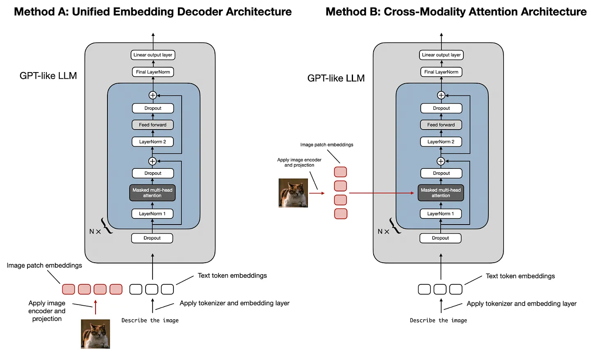
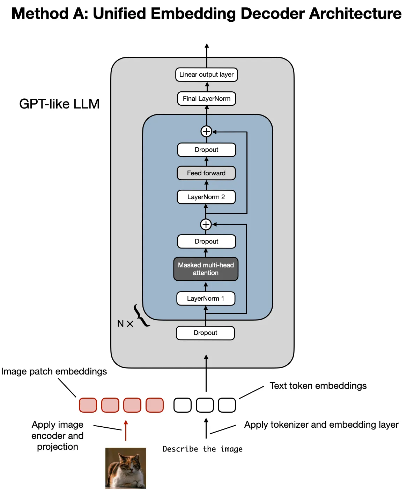
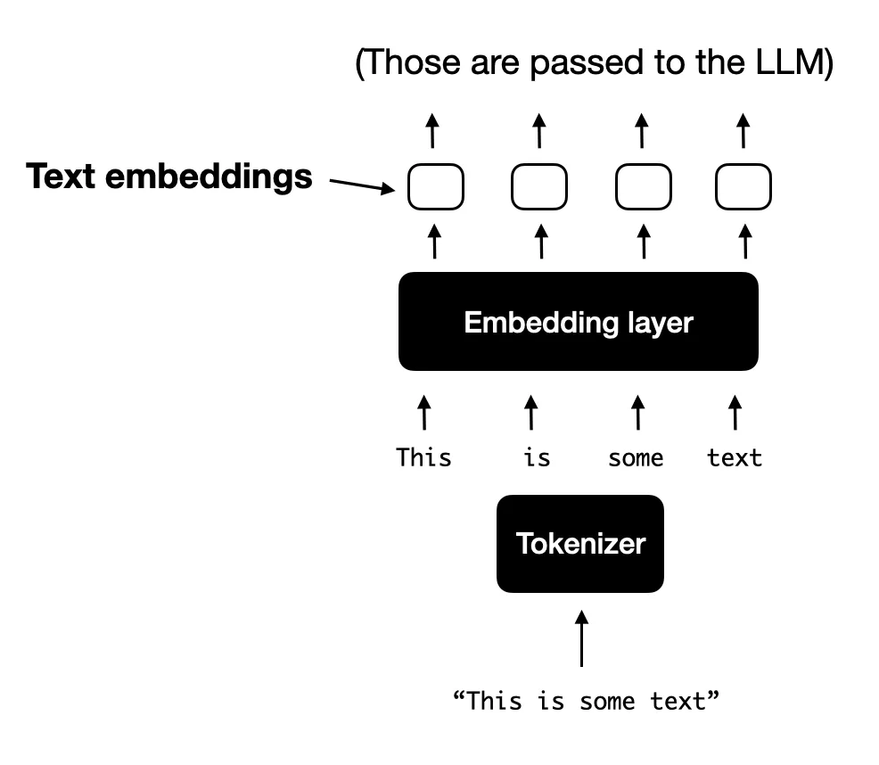
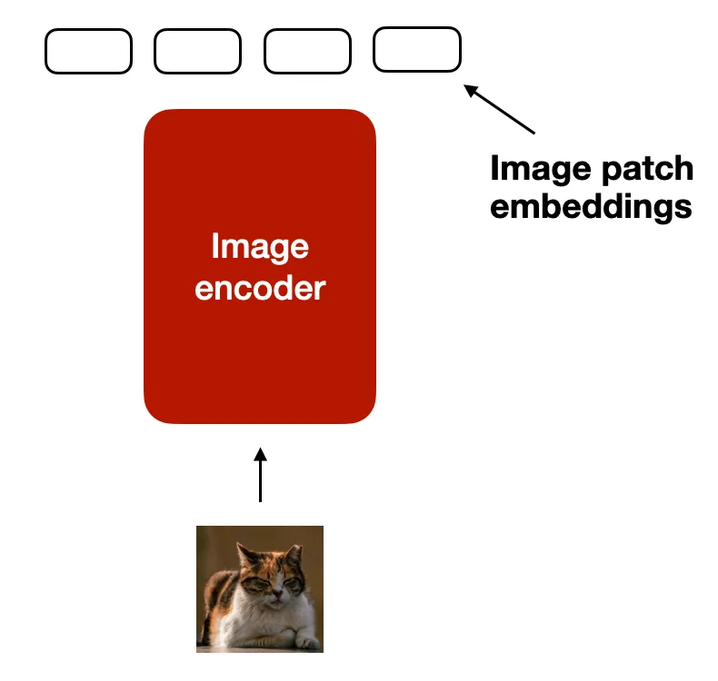
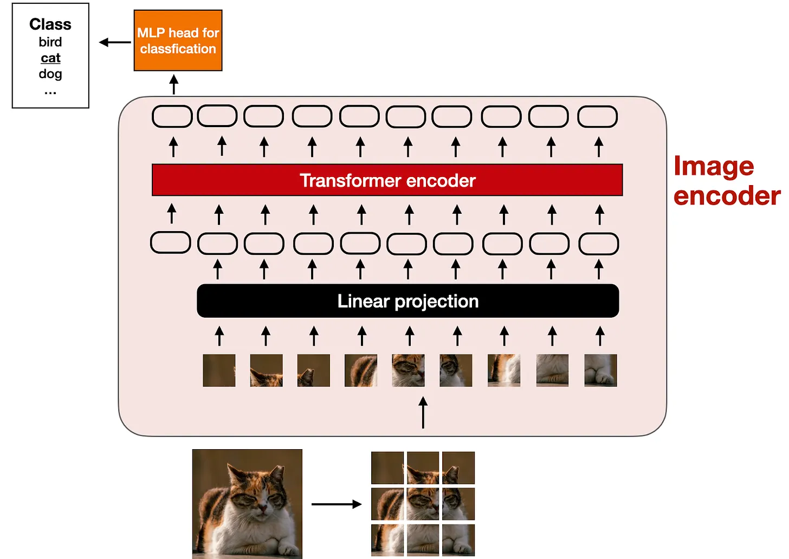
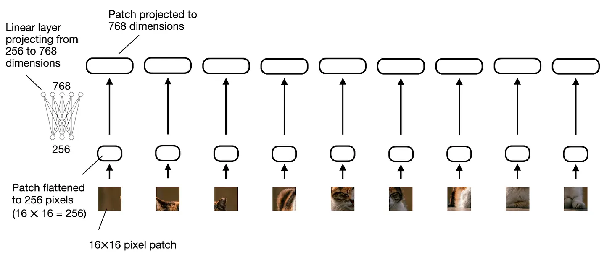
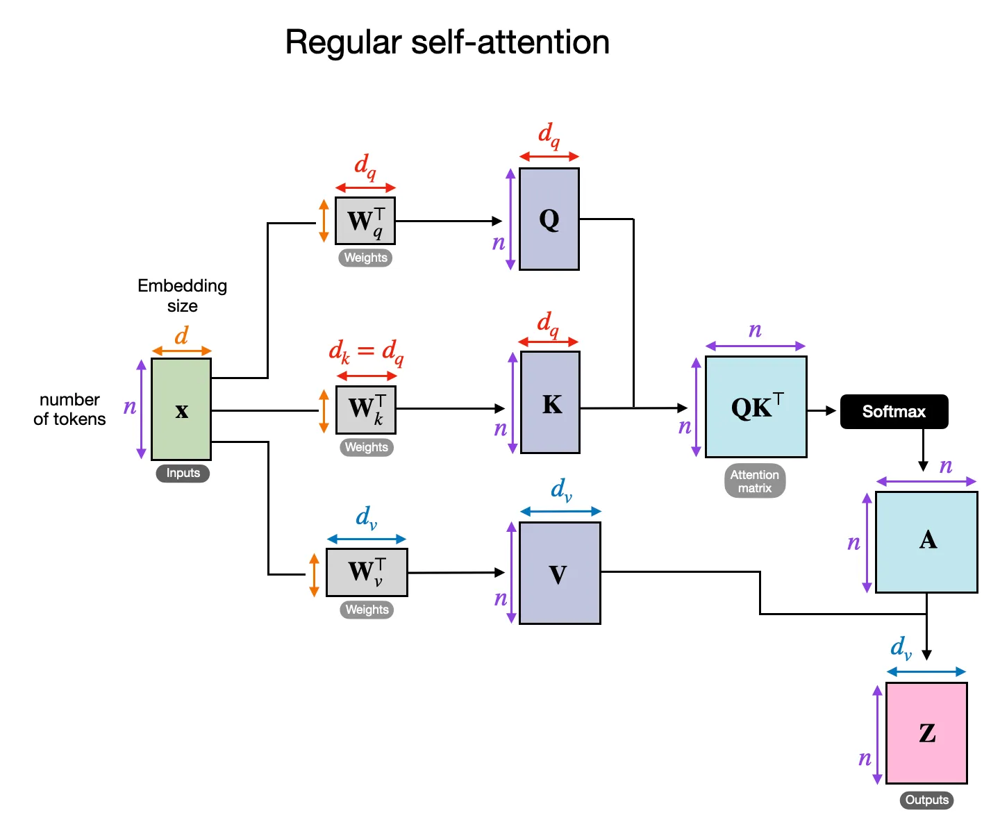
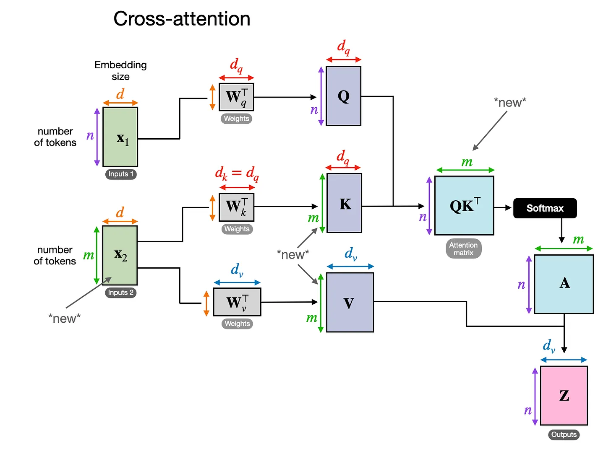
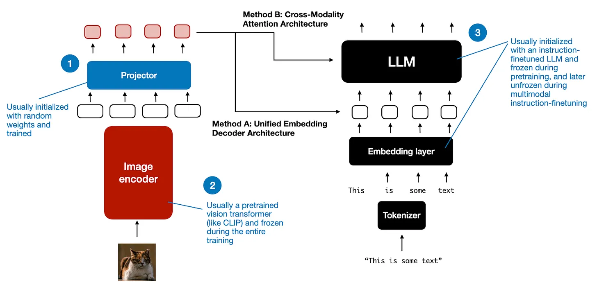
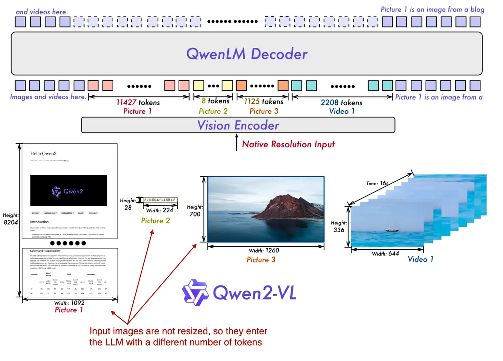

## VLM은 어떻게 LLM이랑 다른가? 
https://magazine.sebastianraschka.com/p/understanding-multimodal-llms

2024.11 게시물 

### VLM에서 하는 일 
image를 input으로 받아서, image에 어떤 내용이 있는지 작성해주거나, pdf 표 같은걸 markdown표로 바꾸는 등 

### VLM 만드는 흔한 방식  

A: Unified Embedding Decoder Architecture (decoder only) 
B: Cross-modaliy Attention Architecture approach (cross-attention-based)

multi-modal llm이라고 하잖나. modality 라 함은 specific type of data를 의미한다. 

A는 image를 text token과 같은 임베딩 사이즈로 바꾸고, LLM이 프롬프트로 들어온 text랑 image token을 붙인 문장을 처리하게 한다 .

B는 반면 이미지 표현이 시퀀스 밖에 있다. 중간에 Q-KV 로 나눠져서, Q랑 각 K 곱해서 각 V가 얼마나 반영되야할지 알 때, KV를 제공하는 방식인것. 컨텍스트 길이를 이미지가 소모안함 

Qwen2.5-VL 정도에서는 순수하게 A를 썼는데, Qwen3-VL 정도부터는 A에다가 초반 LLM 레이어 여러 곳에 residual+이미지토큰 하는 이미지처리모듈과정을 추가함. 

## 2.1A; Unified Embedding Decoder Architecture

이미지가 embedding vector로 변환됨. 

typical text only LLM 은 tokenize -> embedding layer를 거친다.

image encoder도 비슷하게, image encoder module을 만드는것. 

image를 smaller patch로 쪼개고, pretrained vision transformer(ViT) 로 encode된다. 

pretrained가 아니고 그냥 vision encoder 달기도함 (같이 학습되게) 요즘도 다 ViT단다. 

당시에는 pretrained ViT 대부분의 유즈케이스가 classification이었어서 그냥 이런 일 하는 ViT의 encoder 부분만 갖다 쓴다는 설명을로 위 주황색 블록 넣어놓음 

### 2.1A-2 linear projection

1개의 fully connected layer 뒀다. Image patch들은 16x16이면 256짜리 벡터로 flatten 되어있는데, LLM의 token size랑 맞춰야 해서. 

## 2.2B - Cross-Modality Attention Architecture 

encoder로 patch들의 임베딩 만드는건 똑같은데, multi-head attention layer에 cross-attention 방식으로 넣는다. 

보통 token들의 목록이 들어오면, 각각이 Q, K, V 벡터로 변환되고, 

어떤 vector가 어떤 비율로 필요한지 QK를 통해 구해서, 그 비율 A만큼 각 토큰의 V를 합해서 Z token output을 만든다. 

요 k,v 벡터가 이제 이미지 input만큼 더 추가됨. 

## 3. 어떻게 각각 트레이닝 시키나요? 

projector는 image endoer에서 나온 embedding이 llm embedding이랑 차원 맞출 수 있게 하는거. 

초기에는 LLM이나 비전 인코더를 freeze해놨는데, 일부 단계부터는 LLM과 비전 인코더를 모두 unfreeze한다. 

그리고 요즘은 (Qwen2.5, 3-VL) 텍스트 전용 목적함수랑 멀티모달 목적함수 동시에 돌려서, 한쪽 학습만 돌렸을때 한쪽 능력이 깨지는걸 부수기. 

gemini 같은경우는 아예 모든 모달리티를 처음부터 하나의 토큰 스트림으로 학습시킴. 

## 4. A와 B 뭐가좋아요?

A: LLM 아키텍쳐 안바꿔서 편하다 

B: computationally efficient (중간부터 들어가니까 input이 너무많아지는걸 방지)

## Qwen2-VL에서 한 짓 

Naive Dynamic Resolution 

The training itself consists of 3 stages: (1) pretraining only the image encoder, (2) unfreezing all parameters (including LLM), and (3) freezing the image encoder and instruction-finetuning only the LLM.

이미지마다 다른 크기의 token이 나올 수 있음! 

