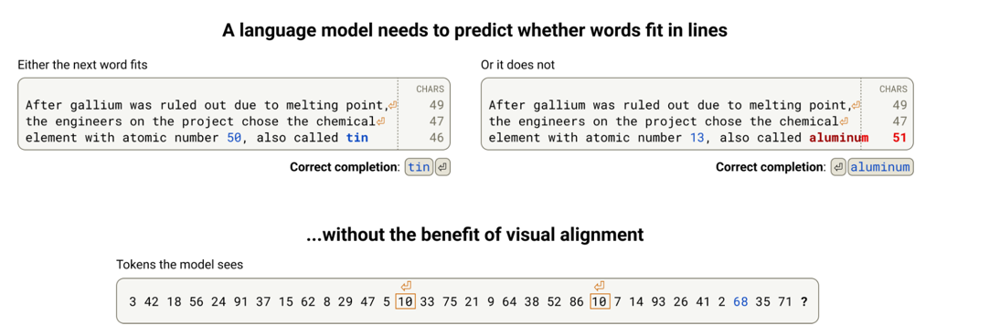
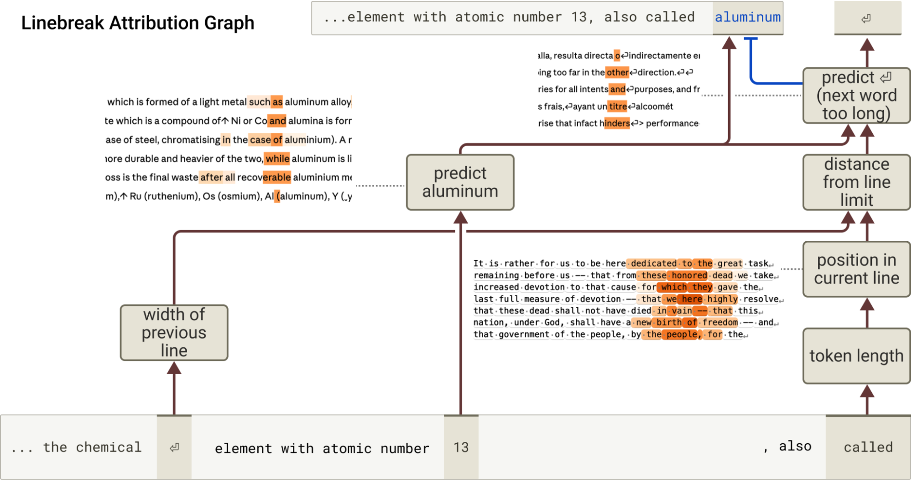
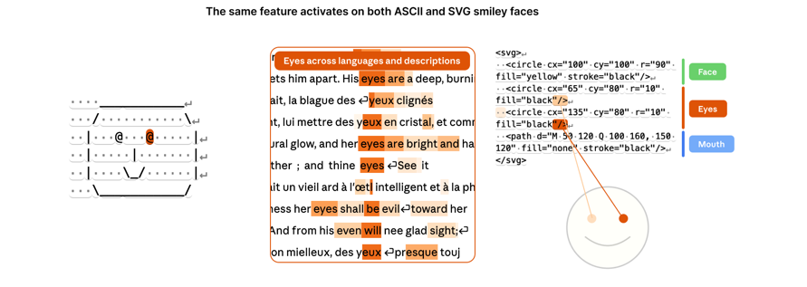
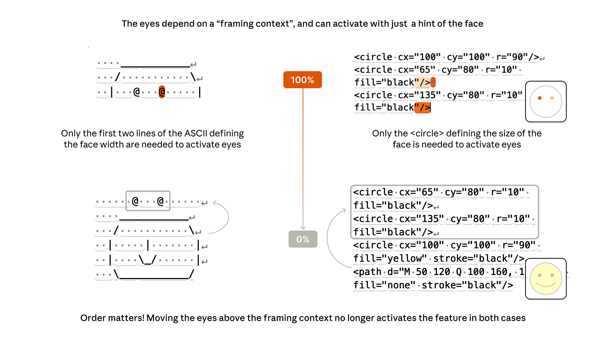
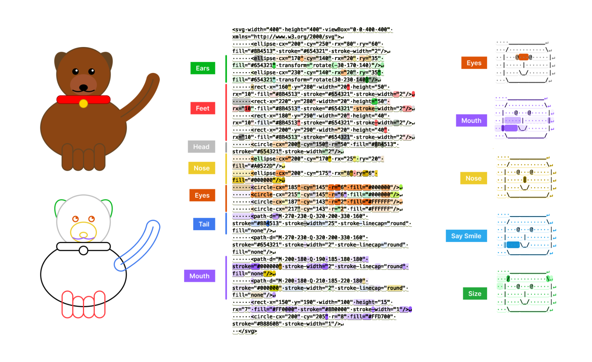
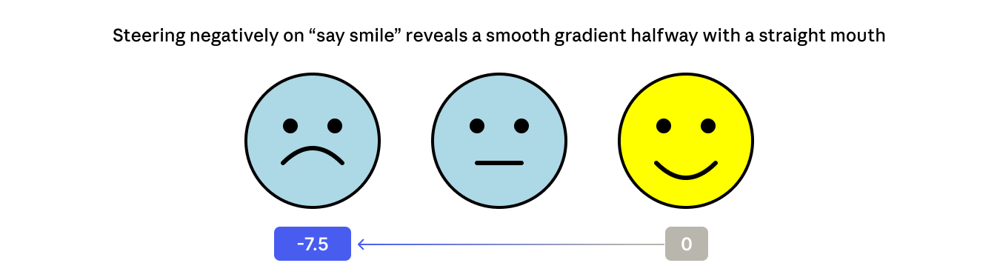

## When Models Manipulate Manifolds: The Geometry of a Counting Task

https://transformer-circuits.pub/2025/linebreaks/index.html

perception을 이용해서 environment를 이해하고, 예측하고, 방향을 잡는다. 

LLM도 visual, spatial reasoning 필요한 task를 마주한다 
- ASCII art, table 이해, text wrapping

근데 LLM이 실상 받는건, token을 표현하는 정수배열. 

일단 fixed-width text에서 어떻게 line breaking을 해야할지 연구해봤다. 

### attribution graph
서로 어떤 feature들이 서로의 발현에 영향을 주는지 확인가능 

지난 line의 width가, called라는 현재 토큰의 길이에서 온 정보랑 합쳐져서, 다음단어 대신에 line break를 해야하는지 안다. 

즉,

1. 현재 어떤 position인지 (character count), 전체 줄 길이 (constraint)가 각 token length 특성들을 모아서 계산되게 된다.
2. 현재 position 과 전체 줄 길이제한을 합쳐서, estimate of characters remaining feature를 만든다
3. estimate of characters remaining feature로 다음 단어가 fit in the line or not 할지 구한다.

### 핵심 발견: 카운트는 "리플 매니폴드"에 얹혀 있다

문자 수를 선형 프로브로 뽑으면 layer 1 잔차 스트림에서 R² 0.985가 나옵니다. 하지만 1차원 직선으로 표현되는 게 아니라, **6차원 부분공간(분산 95%) 안에 심하게 휘어진 1차원 곡선** 형태입니다. PC1–3에서 보면 나선처럼 보이고요.

이걸 이중으로 해석할 수 있다는 게 논문의 프레임입니다:

-   **이산 feature 관점**: 10개의 문자 수 feature가 각자 다른 범위에 반응하며 곡선을 타일링. 뒤쪽 feature일수록 수용 영역이 넓어지는 dilation이 나타나는데, 이건 비전 모델의 curve detector, 생물 뇌의 place cell과 구조적으로 닮았습니다.
  - 문자 수가 1인 모든 토큰의 layer 2 residual vector를 평균내보고
  - 2인 .. 
  - 150까지 반복하니 150개의 벡터가 나왔다.
    - 알루미늄 조사할때 feature 2개가 줄 문자 수가 35-55일때, 45-65일 때 켜지는걸 발견해서, 위치를 세는 feature가 있다는 확신을 얻었음
    - 그래서 줄의 문자 수를 센거고, 문자 수에 따라 실제로 반응이 큰 (분산이 큰) feature들을 확인할 수 있었음.
    - 그리고 실제 벡터들을 넣어보니, count 45짜리는 feature4,5가 비슷한 세기로 겹치고, (feature4: 35~45, feature5: 45~55) 하더라.
    - 10개 feature로 150개 값이 구분이 가능하다. 

## Visual Features Across Modalities: SVG and ASCII Art Reveal Cross-Modal Understanding
https://transformer-circuits.pub/2025/october-update/index.html

줄바꿈같은 저수준 시각 속성을 다뤘다면, 텍스트로 인코딩 된 고수준 의미 개념도 지각할 수 있을까? 

ASCII얼굴에서의 눈, SVG 코드로 그려진 눈은? 

결과1. cross modal feature

- ASCII 얼굴의 눈에 반응하는 feature가 SVG코드의 눈, 여러 언어로 쓰인 '눈' 과 관련된 문장들에서도 발화됨 
- 눈, 코, 귀, 입, 개, 고양이 등등 

결과2. 맥락 의존성이 강하다

- @ 하나만 던져주면 눈 feature가 안 켜지고, ASCII 아트를 성립시키는 줄들이 있어야 켜진다.
- SVG의 경우엔 얼굴 윤곽을 만드는 원이 먼저 나와야 한다. 

결과3. 지각 feature 과 motor feature가 다르다 

motor feature은 'say smile'같은건데, 입력에 'smile' 있다고 켜지는게 아니라, 다음 토큰에 'smile'이 나와야 할 때 켜진다. 

지각 feature은 'smile'같은건데, 입력에 'smile'이 있을때 켜지는것. 

motor feature를 steering 하면 (say smile을 음의 방향으로 밀면 찡그린다) 더 효과적이다. 출력을 바꾸는 feature이다. 

지각 feature를 바꾸는건 모델에게 해당 input이 들어왔냐 안들어왔냐로 바꾸는 것. 

