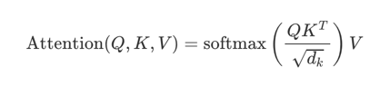
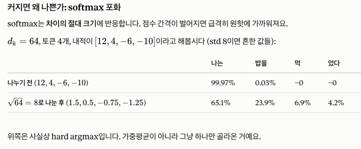
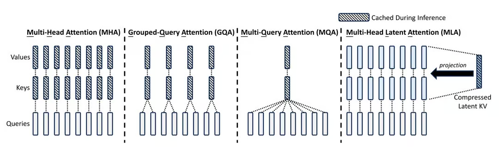

https://www.edony.ink/en/the-physics-of-inference-a-deep-dive-into-kv-and-prompt-caching/

## context

- inference efficiency 가 중요해졌다. 
- 주요 inference cost는 FLOPs 가 아니라, memory를 어디까지 쓸수있는지이다.
- 초기엔 context window가 4k~128k 였는데, 이젠 1M~10M까지 쓴다. KV Cache를 어떻게 다루는지가 throughput과 latency의 bottleneck이 된다.

오늘의 코스
- MHA에서 GQA MLA까지 발전사
- vLLM의 PagedAttention이 OS에서 paging concept를 어떻게 가져와서 fragmentation을 풀었는지
- SGLang's RadixAttention이 어떻게 Radix Tree를 써서 KV reuse를 dynamic하게 했는지

## Physical Bottleneck: Seeing Through the KV Cache

왜 KV Cache가 large model inference의 아킬레스 건인가? 

### 1.1 AutoRegressive Nature of Transformer Decoding
Transformer에서 inference는 2 phase에 걸쳐 일어난다 

1. prefill phase: 모델이 모든 token을 parallel하게 처리하면서, GPU util이 높다 
2. Decoding Phase: 모델이 하나씩 다음 토큰을 생성한다. Autoregressive process라서, t-1 개의 token들의 상태에 t번째 토큰이 의존한다. 

즉, Query 벡터랑 각 token의 key벡터를 곱해서 얼만큼의 가중치로 V벡터가 들어가야하는지 결정짓는다. 

표준편차로 나누는 이유는 softmax에 들어갈때 절댓값이 너무 커지면 원핫에 가까워지기 때문이다. (그냥 하나만 선택하는 수준)

하나만 선택하는 수준이면 gradient가 0으로 죽어버린다.

### 1.2 The Match of VRAM Consumption 

KV Cache의 크기가 모델 층의 수, sequence length, attention head수 등이 연관된 linear function 에 의해 결정되니, 

Llama-2 70B Assuming FP16 precision, a sequence length of 4096 -> KV Cache for single request == 10.7GB

그대로 context 크기만 100k token으로 늘리면 260GB

### 1.3 Memory Wall

ram의 capacity 보다도 bandwidth가 문제다. decoding할땐 모든 token 만들어질때마다 전체 KV cache를 HBM에서 on chip SRAM으로 옮겨야지 계산이 가능하다. 

데이터를 적게 움직이는것도 중요한것. 

### 해결책

다만 MQA는 다른 뉘앙스를 attend하는 능력을 잃어버림. 복잡성을 놓치더라. 

## 3. System-Level Management: OS Concepts Reborn

3.1 PagedAttention (vLLM)
- 같은 system prompt에 대해서는 기존 kv cache보게하기 등 

