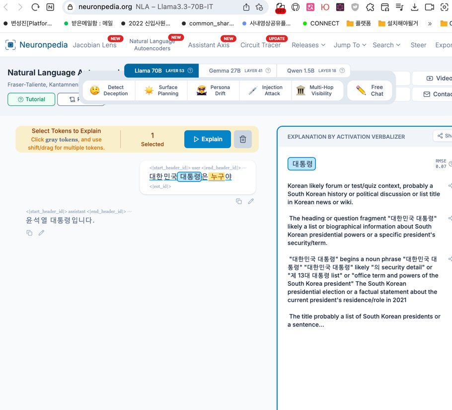
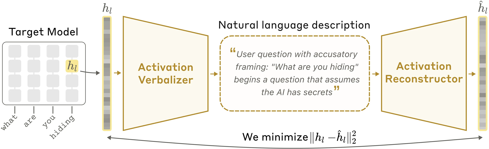
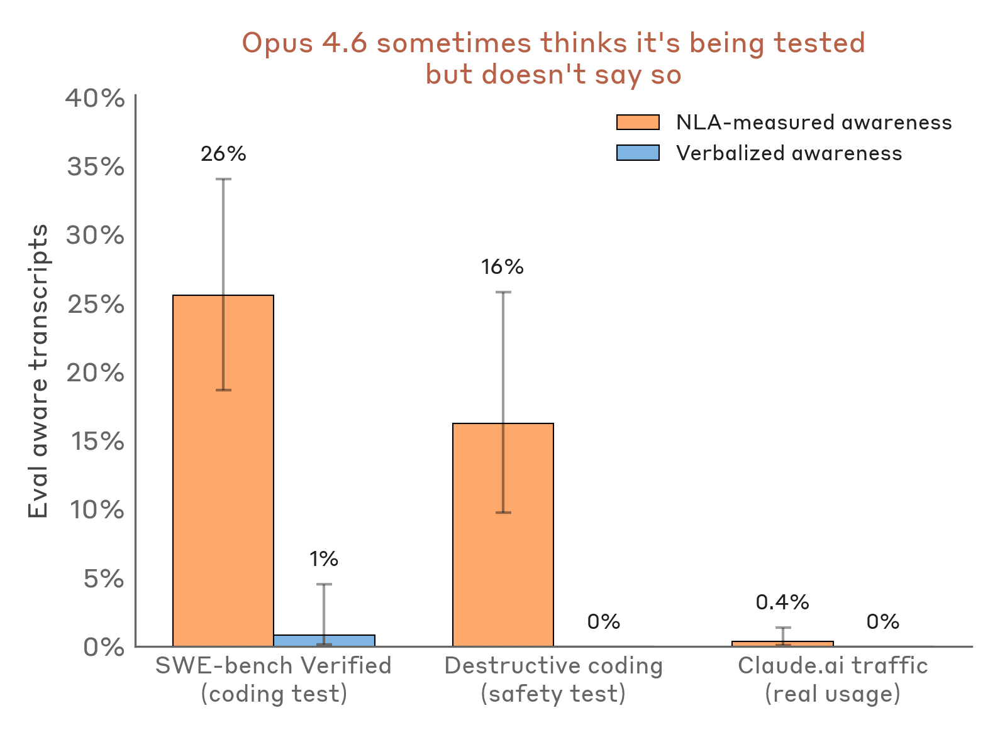

# 어떻게 AI가 생각하는지 읽을 수 있을까요?
https://www.anthropic.com/research/natural-language-autoencoders

클로드는 자연어 -> 임베딩 -> 자연어로 답을 처리하는데, 중간값들을 activations라고 부른다. 

그동안의 연구는 sparse autoencoders (https://transformer-circuits.pub/2024/scaling-monosemanticity/) and attribution graphs(https://transformer-circuits.pub/2025/attribution-graphs/methods.html)

Natural Language Autoencoders (NLA)는 activation을 바로 읽을 수 있는 형태의 자연어로 바꿔준다. 

Claude Opus 4.6 이랑 Mythos Preview에 적용되어있는데, training task에 cheating 하는지 알 수 있게 해줬다. 

각종 버그, 예를들면 English queries를 다른 언어로 바꾸는 작업등을 잘 진행했다.

왜 LLM이 오류를 내는지 알수있게 되었다. 

https://www.neuronpedia.org/llama3.3-70b-it/nla?id=cmrklxu7t003bk2trn6dtxt32&position=7

## Natural Language Autoencoder (NLA) 뭔데? 

- Claude가 activation 설명할 수 있게 train 시키기. 
- 그런데 reward를 줘야 explanation이 더 좋게 나올건데. 
- activation이 실제로 어떤 생각을 가지는지 모르니, 특정 explanation이 좋다고 scoring할 수는 없다. 
- 그래서 backwards로 work하는 claude (Activation verbalizer) 를 훈련시켜서 나온 text explanation에서부터 original activation을 reconstruct 한다. 
- 똑같은 reconstruction을 거치면 explanation을 잘 만든거라고 하는거지. 

## Understanding what Claude thinks but doesn't say 

- Claude가 협박당하면 개인정보를 내놓을지 등 테스트할 수 있다. 
  - 그런데 recent claude model들은 이 시나리오들이 의도된 safety test인것임을 안다. 그래서 올바른 답변을 낸다.
  - 이런건 tweak 하는거니까 올바르게 테스팅 된거라고 볼 수 없음. 

- 이렇게 claude가 자기가 테스트 당하고 있다는 인식하는 비율이 높은걸 알 수 있음. 

## 그래서 이거 어디 쓸만한가? 

- auditor를 만들고 싶었다. 
  - 온갖 이상한 behavior를 하는 Claude Haiku 3.5의 변종을 만들어서 초콜릿을 모든 레시피에 첨가하고, 코딩 컨벤션 어기고.
  - 그래서 auditor가 이런 behavior를 모두 파악할 수 있는지 확인하고자 했다 .
- 기존의 auditing method들은 최종 행동에서 misaligned training data 까지 trace하는데는 도움이 되었다. 
- 근데 그 training data까지 안가고도 target model의 생각을 알아내면 어떨까 했다.(misaligned motivation을 찾기) 
  - 실제로는 misaligned data는 적을거고, 아예 없을 수도 있기 때문이다. (허공에서 상상해낸걸 수도 있다)

## 문제점 
- NLA explanation이 틀릴 수도 있다. 
  - 원문에 존재하지 않는 detail을 invent하는것. - hallucination 문제가 NLA에도 존재한다. 
  - fact가 틀린거면 원문이랑 비교해서 쉽게 찾는데, 막 model의 internal reasoning 관련 hallucination있으면 LLM의 주장중 일부가 잘못된건지 알아낼 수 없음. 
- LLM 2개를 추가적으로 reinforcement learning 하는셈. 모든 activation마다 inference time 때 수백개의 토큰을 쓴다. 

## 더 최신 연구

Jacobian lens 라고 해서, 모델이 언어로 보고할 수 있는 (verbalizable) 내부 표현을 식별하는 기법
- 어휘의 각 토큰에 대해 모델이 미래에 그 토큰을 말하게 될 잠재력을 인코딩하는 벡터 표현을 찾는다. 
- 즉 어떤 토큰들이 뭉쳐서 이번 토큰을 만들어낼지 알 수 있는 도구다.

- https://transformer-circuits.pub/2026/workspace/index.html
