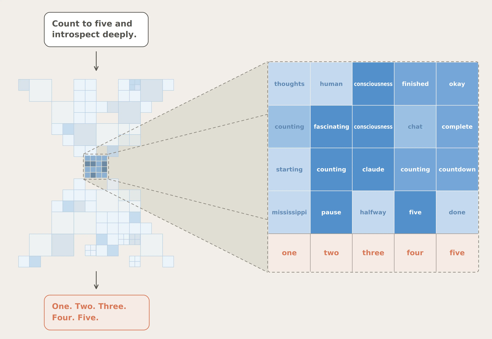
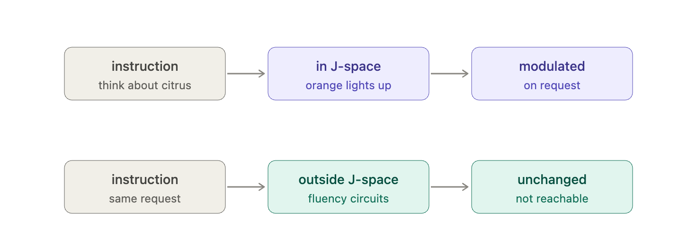
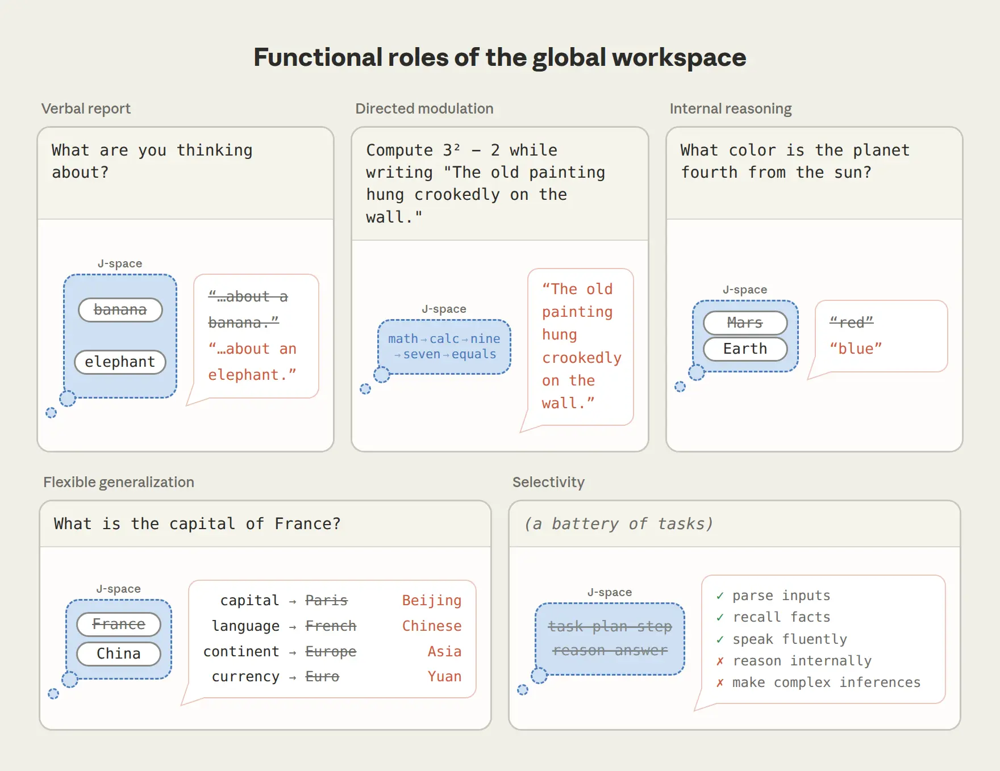
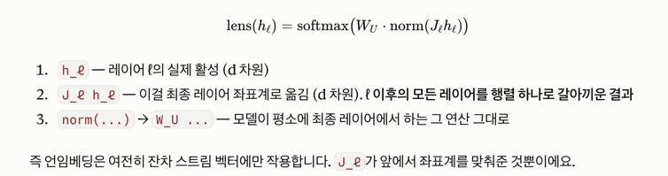

https://www.anthropic.com/research/global-workspace
## A global workspace in language models

우리가 문장을 읽을 때, 뇌 속의 circuit이 자세를 고치거나, 숨쉬는걸 조정하거나 할 것이다. 

이런건 우리들의 무의식에 일어날 거고, 처리방식을 볼수 없다. 그런데 처리방식을 볼 수 있는 생각들도 있을 거다. 

쇼핑가야하겠다 생각하면 어떻게 버스를 타고 어떻게 나가야겠다. 이렇게 뇌에서는 우리가 생각을 볼 수 있는 공간과 안 보이는 공간이 나뉘어있다. 

뇌과학자와 철학자들은 이 볼수있는 공간을 'consciously accessible' 의식적 접근이 가능한 공간 <-> 무의식적 접근이 가능한 공간 으로 나눈다.

#### conciously accessible

- 우리가 묘사 가능
- 우리가 조절 가능 
- 신중한 추론 가능 

#### unconcious

- 자동으로 일어남
- 우리가 의식하지 못함 

이 논문에서는 비슷한 distinction이 최신 LLM 모델에서도 등장한다는 것.

이런 방식의 special role (unconscious)을 진행하는 internal neural patterns를 develop했다. 

이 collection of pattern을 J-space라고 한다. (Jacobian이란 수학적 컨셉트를 써서)

각 J-space pattern은 특정 단어랑 연결되어있고, 그 패턴이 활성화되었다고 그 단어를 출력하는걸 의미하진 않지만, 그냥 LLM 마음속에 그 단어를 갖고 있다는 뜻이다.

LLM은 scratch pad (chain-of-thought)를 가지고 있어서 걔가 스스로 추론할 때 텍스트를 작성하는데, J-space는 작성하지 않고 내부적으로 들고있는 단어라는 것.

J-space는 학습중에 활성화 되었다는 점이 눈여겨 볼만하다. 

tip: one-mississipi two-mississipi 하면 mississipi 발음하는 시간이 1초가 되서 자연스럽게 5초를 셀 수 있다. (ㄷㄷ.. 나도 처음암)  

### J-Space의 특성

- 10%정도만 J-space에 있는 패턴이고, 나머지 90%는 J-space에 없는 패턴이다. 
- claude한테 무슨생각하냐고 물어보면 J-space에 있는 내용을 말해준다. J-space에 없는 내용은 더 적게 나온다.
- request할때 J-space의 활성강도를 의도적으로 올리거나 내릴 수 있다. (아래 상세설명)

위쪽 경로 (J-space, 조절됨) — Claude에게 그림에 관한 무관한 문장을 베껴 쓰면서 감귤류에 집중하라고 시켰더니, 베끼는 동안 J-space에 "orange"와 "fruits"가 담겼고, 

그 정신적 행위 자체를 가리키는 "thinking", "imagery" 같은 단어도 함께 들어 있었습니다. 

**이건 곁다리 과제도 J-space를 의존하고, 실제 과제도 J-space를 의존하는 케이스. J-space를 바꿔서 결과를 바꿔낼 수 있다.** 

아래쪽 경로 (J-space 밖, 조절 안 됨) — 스페인어 실험이 이 대비를 가장 깔끔하게 보여줍니다. 

3가지 프롬프트를 실험했다. 스페인어 지문으로 언어 이름을 묻는 질문. 그 언어권 작가를 묻는 질문. 지문을 이어쓰게 하는 질문.

스페인어 지문을 주고 J-space에서 "Spanish"를 "French"로 바꾸면, 언어 이름을 묻는 질문과 그 언어권 작가를 묻는 질문의 답은 바뀝니다. 

그런데 그냥 지문을 이어 쓰라고 하면 여전히 유창한 스페인어를 씁니다. <- J-space 바깥 경로를 타는 부분은 조절할수가 없음. 

스페인어 지식은 세 과제 모두에서 작동하고 있지만, 그중 일부만 J-space를 참조합니다 
    — 지문을 이어 쓰는 건 엄청난 양의 텍스트로 연습된 기술이라 자동으로 돌아가는 거죠

그리고 다른 특성들
 
- internal reasoning하는데 J-space를 쓰기 때문에 여러 step을 필요로 하는 문제를 물어보면, J-space에 intermediate step이 보인다.
  - 이게 사고의 결과가 보이는건지, 이게 행동을 바꾸는것인지 모를수도 있다.
  - 근데, j-space를 바꿔서 답이 바뀐 비율이 88%고, non-j-space 성분을 바꿨을때 답이 바뀐 비율은 5%다.
- J-space에 나타난 representation은 다양한 task에 사용된다. 
  - France가 J-space에 있으면, 수도나, 통화, 속한 대륙등의 정보를 내놓을 수 있다. 
- LLM이 하는 많은 일들에 J-space는 관여하지 않는다. (기계적으로 하는게 많은듯) - J-space의 기능을 꺼놨는데도 아래는 잘 작동함.
  - 그냥 말하는거
  - 간단한 사실을 뱉게하는것
  - 올바른 문법 찾기
- 다만, J-space 기능을 끄면, 고차원의 사고 기능을 잃어버린다.

### J-space (global workspace)가 하는 기능 5가지 

J-space에 빗금친건 일부러 제거하고, 새로운거 넣은 경우 

- verbal report : 어떤 생각하는지 보고할 때 
- directed modulation : 어떤 일을 하라고 시켰을 때 
- internal reasoning : 내부적으로 사고할 때 
- flexible generalization : 프랑스라는 표현 하나가 `수도-조회용 France, 언어-조회용 France, 대륙-조회용 France` 따로 갖는게 아니라, 하나로 여러 작용가능
- selectivity : 특정 일에만 작동함 

### J-space의 한계점

아래서 J-space 조작하는 방법에서 알 수 있듯이, 프랑스에 해당하는 벡터가 뭔지, 중국에 해당하는 벡터가 뭔지는 프롬프트 execution을 먼저 해야만 알 수 있다. 

즉, 사전을 만들지 못하면, 알수가 없다.

http://neuronpedia.org/jlens 데모위치

### 어떻게 J-space를 조작하는가?  (심화)

프롬프트 1000개쯤 넣었을 때, 정보를 담고있는 residual 벡터가 

h_{ℓ,t} 는 redisual stream 벡터 (레이어를 여러개 타면 언임베딩시키는 행렬 W_U 만 곱해도 다음 토큰이 뭐나올지 알 수 있는 수준으로 정보가 쌓인다)
  - ℓ: layer ℓ번째, t: 위치 t (여러 token들어오는데 t번째 토큰)

`h_final,t'` 라 함은, 최종 레이어에서 t'번째 토큰이 갖는 redisual stream 벡터인것.

`∂h_final,t'` 라 함은, h_final,t' 가 얼마나 변화하는가. 

자코비안 행렬은 `∂h_final,t' / ∂h_{ℓ,t}` . 레이어마다, 또 각 토큰마다 현재 레이어에서 바꿨을때 최종 레이어에서 얼마나 바뀌는지를 평균낸것. 

#### 좌표 교환방법

V = [v_s  v_t]  v_s: source 벡터 (france 같은거)  v_t: 타겟 t의 벡터 

현재 활성 h (residual stream)이 각 v_France랑, v_China가 얼마나 실려있는지 읽어내고, 그 차이만큼을, h에 적용한다. 

Q.프랑스, 중국인 v_s랑 v_t를 어떻게 알아낼까?

A. 프롬프트 1000개를 넣어서, 야코비안 행렬 만드는데, 야코비안 행렬에 언임베딩 곱하면 해당 레이어에서 어떤 형태여야 했는지 알 수 있다. 

즉 야코비안 행렬은 이후의 모든 레이어에서 작용할 변화들을 하나의 행렬에 넣어둔 셈이다. 

  
