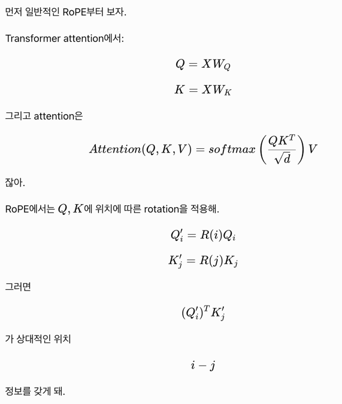
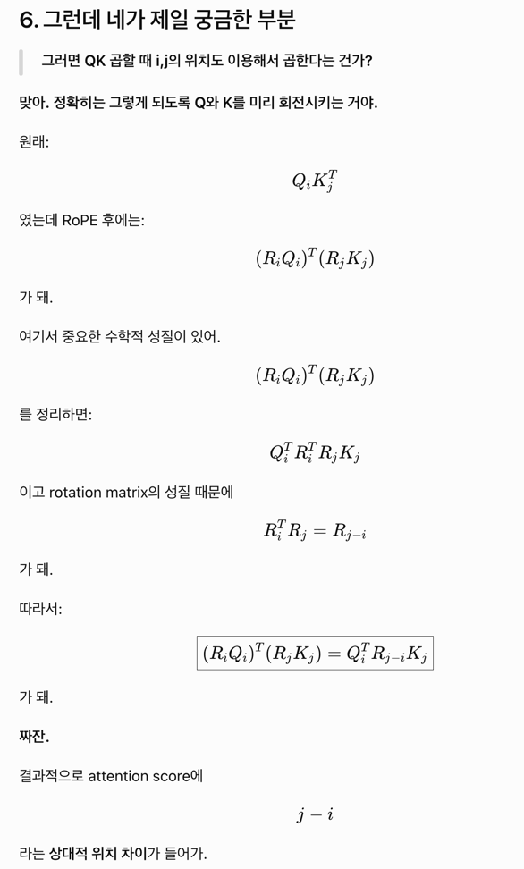
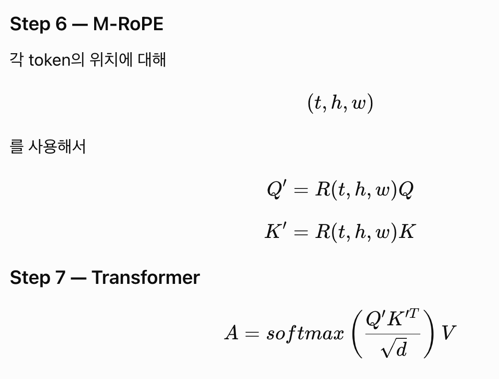

https://qwen.ai/blog?id=qwen2-vl

```
                    IMAGE
                      │
                      ▼
             ┌─────────────────┐
             │ Vision Encoder  │
             │      ViT        │
             │    ~600M        │
             └────────┬────────┘
                      │
                visual features
                      │
                      ▼
              visual tokens
                      │
                      │
TEXT ────────────────┐│
                     ▼▼
             ┌─────────────────┐
             │     Qwen2       │
             │      LLM        │
             │                 │
             │ Transformer     │
             │ + M-RoPE        │
             └────────┬────────┘
                      │
                      ▼
                   OUTPUT
```

전체 구조는 이런모양. ViT가 image를 embedding해서 토큰이랑 같이 LLM에 넣을거다. 

ViT는 단순히 임베딩만 만드는 역할. 

### 일반적인 ViT 

이미지를 patch로 나눠서 patch size가 14라면

14*14*3(색깔 3개) 짜리로 나뉘어. 

근데 보통 resize를 해서 해상도를 조금 낮추는 방식을 썼었음. 

보통은 사진에 등장하는 일부 특성이 중요했기 때문 (고양이냐 강아지냐? edge가 몇개있냐)

연산량도 줄여야 하고. 

### naive Dynamic Resolution

근데 VLM의 경우는 질문들이 달라졌다. 이 글자는 뭐냐, 영수증 총액은 얼마냐, 화면 오른쪽 위 버튼이 모냐 

resolution을 줄이면 일부 정보가 없어진다. 

그래서, 그럼 image해상도별로 다른 양의 토큰이 나오게 하자. 같은 14x14x3 패치를 써도 더 많은 양의 임베딩이 나오게 한다. 

그러면 해상도를 무한히 높이면 될까? 

너무 정보량이 높아지면 계산량이 폭증하기 때문에 항상 해상도를 조금 줄이고, 계산을 적게 하려고 하고 등등 많은 기법이 나왔다. 


```
작은 이미지
       ↓
patch 적음
       ↓
visual token 적음


큰 이미지
       ↓
patch 많음
       ↓
visual token 많음
```

그럼 이렇게 여러 토큰 만들어졌으면, fully connected layer 하나 놔서 token embedding이랑 임베딩 차원 맞춘다. 

## 두번째 문제 

일반적인 positional embedding 하기에 텍스트는 1차원이다. 

위치가 0,1,2,3 이런 1차원 index로 표현된다.

사진은 2차원이고, 비디오는 시간선이 추가되어 3차원이 된다. 이걸 표현해내지 못하면 

a위에 b 있다. b 우측에 c있다.

또는 1초뒤 b 등장. 이런 정보들이 사라진다. (그냥 토큰화 해버리면 )


### M-RoPE (Multimodal Rotary Position Embedding)

위치 정보를 temporal, height, width 세 축으로 분해해서 multimodal sequence에 적용하자는 방식이다. 



일반적인 RoPE는 Query, Key 벡터 앞에 Rotation이 붙는다.

여기서 i,j는 각각 토큰의 위치인건데, 예를들면 토큰 i가 토큰 j를 얼마나 볼지는 (Qi)(Kj)^T 같이 표현되는거다.

Q. 근데 이미지 patch를 token으로 바꾸니까 index정보가 flatten되잖아. 

```
image

┌───┬───┬───┐
│ A │ B │ C │
├───┼───┼───┤
│ D │ E │ F │
├───┼───┼───┤
│ G │ H │ I │
└───┴───┴───┘

flatten

A B C D E F G H I
0 1 2 3 4 5 6 7 8
```

??? 2D 공간관계를 어떻게알지? 

row1 column1 이 없잖아. 

그런데, 여기서 Q랑 K 자체를 위치에 따라 회전을 시켜서 원래의 image 정보를 보존하게 한다. 

(실제로 rotation matrix)



이렇게 rotation을 돌리면, Q*K 곱하는거(attention score) 자체에 j-i 라는 상대적 위치 차이가 포함된다. 

```
A B C D E
0 1 2 3 4
```

A가 D를 보는 경우:

i=0,j=3

이므로 상대 위치는

j−i=3

B가 E를 보는 경우:

i=1,j=4

인데 역시

j−i=3

이야.

근데 1D distance랑 2d Distance가 일치하지 않는다. 

좌우야 1칸 차이인데, 위 아래는 3칸 차이가 되버린다.


그래서 등장하는 M-RoPE

이미지 patch에 단순히 position == i 로 두지않고, (row, column)을 유지시킨다. 비디오도 해야하니, (t,h,w)


```
A B C
D E F
G H I

A → (0,0)
B → (0,1)
C → (0,2)

D → (1,0)
E → (1,1)
F → (1,2)

G → (2,0)
H → (2,1)
I → (2,2)
```




### 생기는 질문들 

row, column 정보를 embedding vector에서 어떻게 attention까지 가져갈 수 있을까? 

애초에 patch 만들때 각자가 몇번째 토큰인지는 안다. ViT (Vision Transformer)도 positional embedding을 각 patch에 더해놓긴한다. 근데 M-RoPE자체는 row랑 column이 필요함.  

```
┌────┬────┬────┐
│ p0 │ p1 │ p2 │
├────┼────┼────┤
│ p3 │ p4 │ p5 │
├────┼────┼────┤
│ p6 │ p7 │ p8 │
└────┴────┴────┘
```

M-RoPE는 구조를 좀 바꿔서, token 별로 position index를 생성해두는 것. 

```
token 0 → (h=0,w=0)
token 1 → (h=0,w=1)
token 2 → (h=0,w=2)

token 3 → (h=1,w=0)
token 4 → (h=1,w=1)
...
```

그래서 별도로 메모리에 h랑 w정보를 들고있게 해서 몇번째 토큰인지 그 정보를 가지고 rotation을 적용한다. 