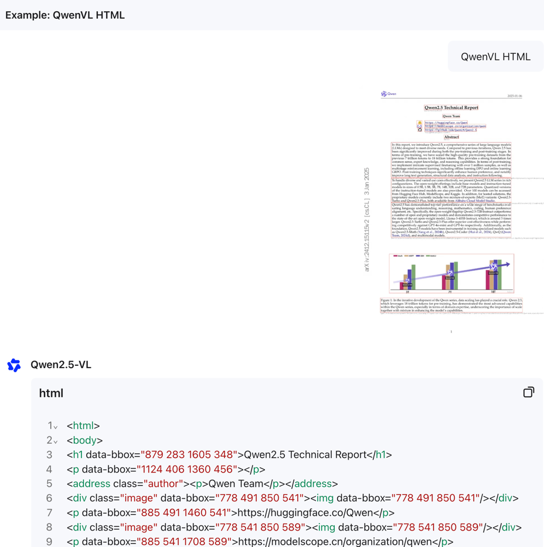
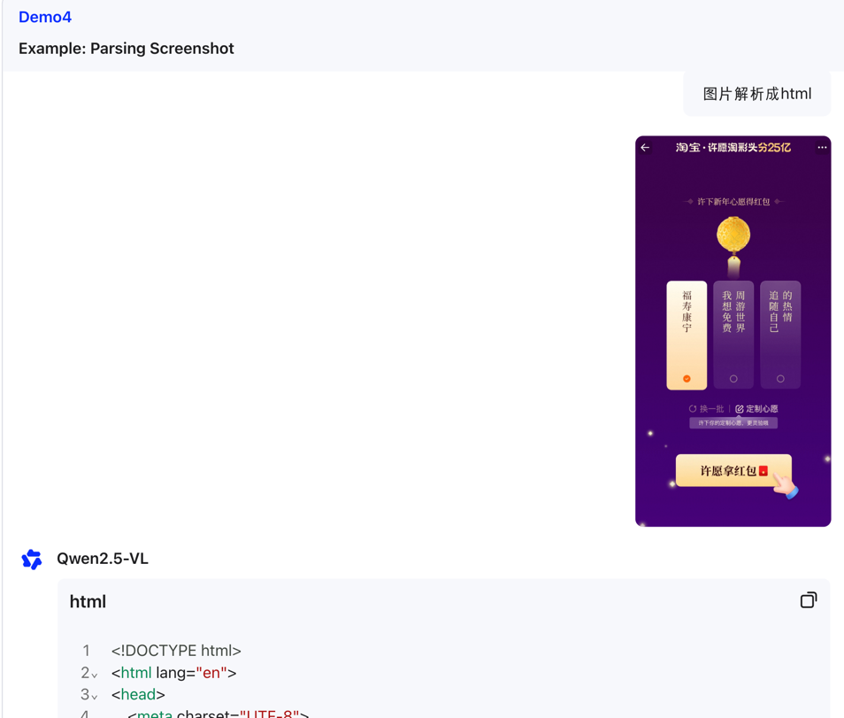
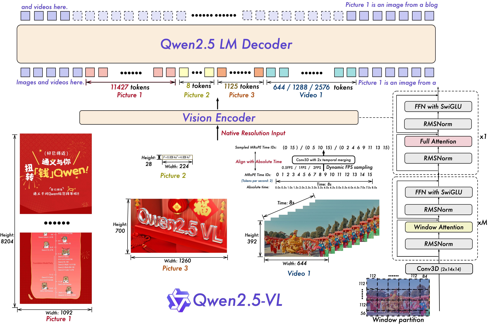
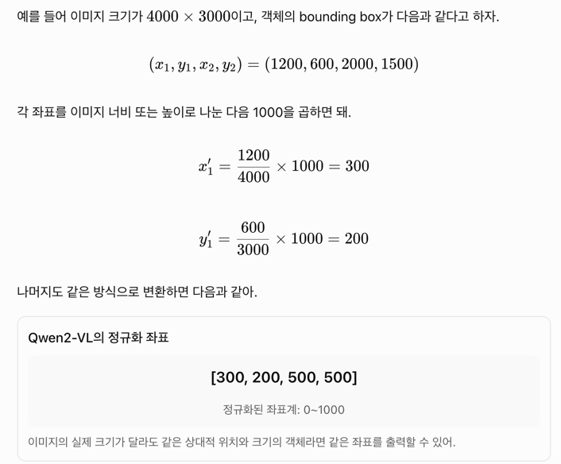
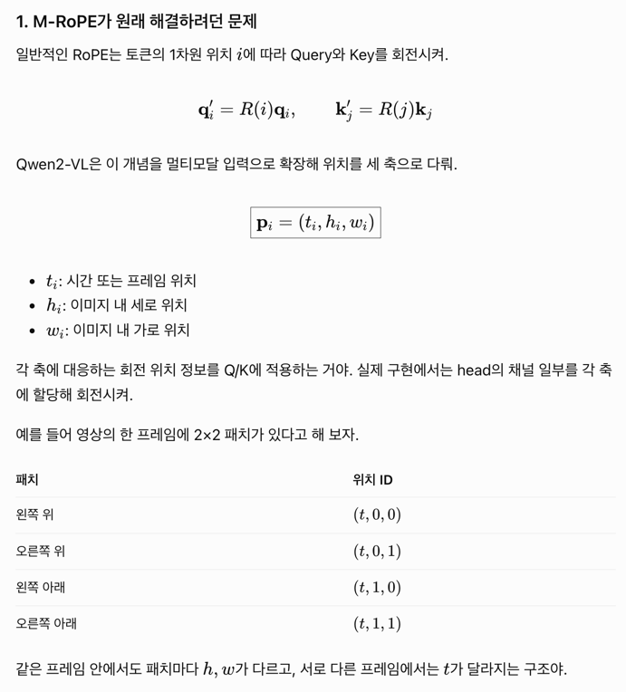
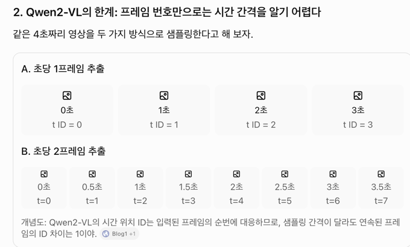
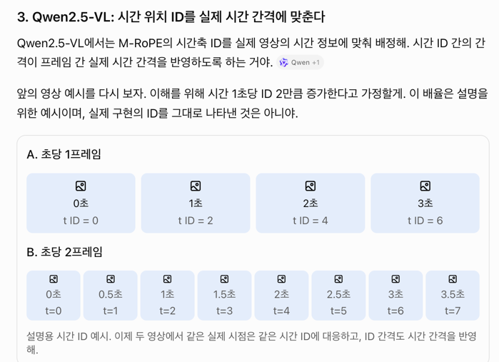
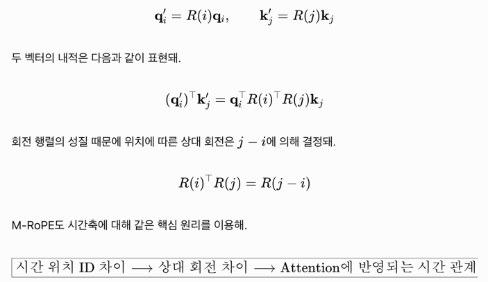
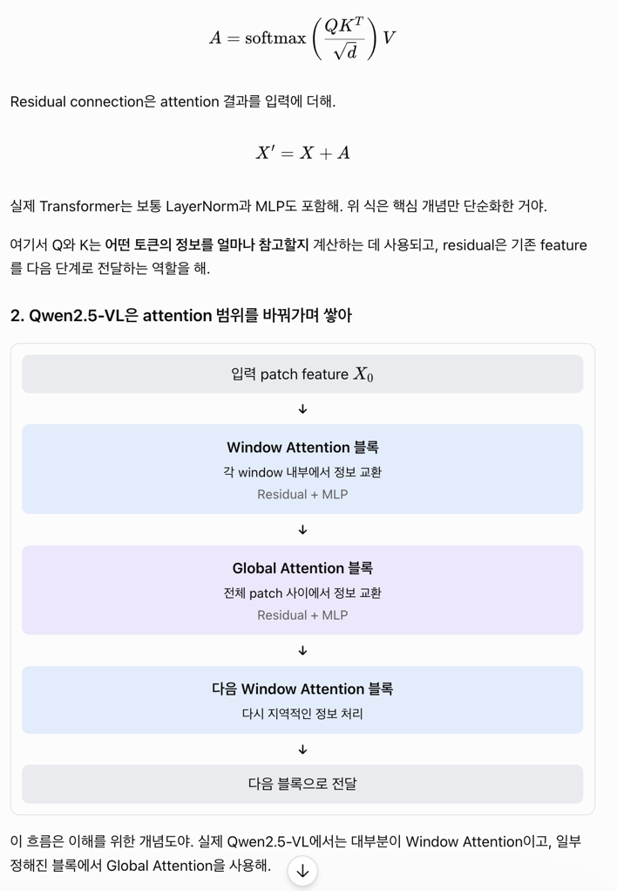

## summary 

https://qwen.ai/blog?id=qwen2.5-vl

뭐가 바뀌었나요? 
- common object (flower, bird) 뿐만 아니라, text, chart, icon graphic, layout within image 분석가능해짐
  - qwen2 VL에서도 되긴했는데 복잡한 레이아웃, 시각정보 향상 (여러 요소 사이 관계 이해능력 강화됨)
- being agentic: visual agent 라서 reason & dynamically tool 사용 
- long video 이해와 event capturing 가능: 1시간짜리 비디오 이해 가능, video segment pinpoint 할 수 있다.
  - qwen2 VL에서도 되긴 했는데, 이벤트의 시간적 위치 파악이 강화됨. (시간 추론에 제약이있었음)
    - e.g. 사람이 처음으로 방에 들어오는 시점은 언제야? (정확한 시간 구간 알아내기)
- 물체 bounding box 생성하기 또는 좌표나 특성에 대한 json 생성 정확해짐 
  - qwen2 VL에서도 되긴 했지만 정확성과 안정성 개선
    - e.g. 컵이 있다 -> 컵이 이미지의 어느 영역에 있는지 명시적으로 출력 
- 구조화된 출력 강화
  - 1과 연결되어서, 구조화된 정보를 그대로 추출하는 능력 강화됨. 

거의 gpt-4o , claude3.5 sonnet 과 비교되는 수준의 성능!  

GPT-4o는 2024년 5월, Claude 3.5 Sonnet은 2024년 6월에 처음 공개됐어. Claude 3.5 Sonnet에는 2024년 10월 Computer Use

문서이해 + 긴 영상의 이벤트 탐색 이 주요 기능이다!  

오호 뭔가 html로 파싱해내는 능력이 생김. 

## 어떻게 개선했을까?

temporal and spatial scale을 늘렸다. 

그리고 network structure을 simplify해서 model efficiency를 늘리려고 했다. 

### 시간을 인지하고, image size를 인지하게 하는 것 

qwen2에서는 image 크기에 따라 토큰 개수가 달라졌는데, 여기에 더해서 

detection box나 point들을 실제 이미지 scale 기준의 coordinate으로 나타낼 수 있다. 

원래는 coordinate normalization 과정같은걸 거쳤었다는데. 

그래서 model이 이미지의 scale을 이해할 수 있게 된다. 

#### 이미지 안 위치를 실제 해상도랑 연결해서 표현한 방식? 

일단 vision transformer가 patch 위치를 표현하는 방식은 

qwen2 에서는 고정된 범위인 [0,1000) 으로 정규화해서 표현했다. 

실제 크기가 달라도, 상대적 위치가 비슷하다면 같은 bounding box 좌표가 출력되겠지. 

Qwen2.5부터는, 실제 이미지 크기 기준으로 좌표를 넣어버린다. (라벨링된 학습데이터도 실제 좌표로)

1. 고해상도 이미지에서 좌표 해상도 손실을 줄임 
  - 좌표 범위를 제한하면 가로 4000이미지에서 가로 1000이미지로 줄이는거고, 100지점이라고 한건 4px을 하나로 뭉개게 된다. x좌표 400,401,402,403은 모두 100지점으로 normalization되니까. 
2. 모델이 실제 공간 스케일을 학습할 수 있다.
  - 서로 다른 해상도에서 객체 찾는 능력 강화된다 (학습데이터가 많기만 했다면야)

### 영상의 시간정보 이해 

temporal dimension에서는 dynamic FPS (frame per second) training과 absolute time encoding이 추가되어서, mRoPE id가 시간의 속도랑 일치하게 된다.  
- 같은 장면을 담은 영상이라도 1초에 1프레임 추출하는 경우랑, 1초에 2프레임 추출하는 경우는 프레임 개수가 다르다. 
- 여러 FPS로 영상을 샘플링해서, 이 프레임이 영상의 몇 초 시점에 해당하는지 spatial 정보를 추가해서 시간 간격과 사건의 발생 지점을 학습한다.

model이 temporal dimension id 차이값으로 시간이 얼마나 지속되는지, 언제 시작한건지 등을 알 수 있게 된다. 

#### M-RoPE가 원래 해결하던 문제 (Qwen2) 

Qwen2 VL에서는 이런식이었다. 시점, 세로위치랑 가로위치값이 rotation할 때 적용되어서 attention 계산시 Query, Key 벡터에 포함되게 한다. 

여기서 한계가 무엇이었을까? 프레임 번호만으로는 시간 간격을 알기 어렵다 . 

fps에 따라서 실제 시간 3초일 때, 3초 전에 일어난 일을 물어보는게, t를 3만큼만 빼야하는 경우도 있고 t를 6만큼만 빼야 하는 경우도 있다. 

#### M-RoPE 수식에서 해결한 방향 (Qwen2.5)

원래 q', k' 내적하면 

시간(t ID), 가로, 세로 정보만큼 회전을 하기 때문에, 같은 가로, 세로 위치에서 3초만큼만 차이나면 3도 정도가 동일하게 차이난다거나 하는 방식으로 학습이 되게 된다. 

qwen2-VL에서는 프레임 순서 차이만큼을 반영했다. 

### ViT에서 Window Attention 사용하고, 일부는 전역 attention 유지 

qwen2에서는 이미지 패치들 사이에서 전역 attention 주로 사용함 

각 토큰이 이미지 전체의 토큰을 볼 수 있게 한것과 달리, 특정 window 안의 토큰끼리만 볼 수 있게하면 어떨까?

패치 수가 커지면 계산량이 제곱되는 것에서, window 크기가 고정되면 attention 비용이 줄어든다.

고해상도 이미지에서는 지역적 세부 정보도 처리가 되니까 더 유리하기도 하다. 

물론 넓은 범위의 관계도 필요한 경우가 있으니 일부는 전역 attention 사용한다. 

#### 기존 attention 

Q*K 연산으로 V가 얼마나 포함되야하는 지 아는데, Q*K연산이 N(이미지 패치 수) * N 연산인셈. 

모든 패치가 모든 패치를 보고 있어. 

#### 신규 attention 

8개의 패치끼리만 보게하면 어떨까? 4사분면처럼 좌상, 우상, 좌하, 우하 이렇게 window를 4개로 나눠서 보면? 

계산이 훤격히 줄어든다. 이미지 하나가 16개 패치가 있는거라고 하면, 512 vs 128 수준으로 연산량이 차이난다. 

#### 어떻게 전역 관계를 유지할까? 

32개 layer를 두는 상황이면, 

7, 15, 23, 31 번 layer에서는 전체 patch끼리 global attention을 하게 하고 나머지만 window attention.

window attention 안에서는 window A와 window B 사이의 patch끼리는 정보 교류 없다.

