https://qwen.ai/blog?id=qwen3-vl

# Qwen3-VL에서 뭐가 좋아졌나요? 
2025년 9월 23일 

qwen3-VL의 목표는 이미지나 비디오 보는거 뿐만아니라, 세상을 이해하고, 이벤트를 해석하고, action을 수행하기 위함이다. 

- Visual Agent Capabilities: 컴퓨터와 모바일 인터페이스 작동가능
- Text-Centric Performance: text based task조차 Qwen3-235B와 유사하다. 
- Visual Coding: 이미지나 비디오로부터 코드 만들 수 있다. (디자인 목업을 draw.io나 html, js code 등으로)
- Spatial Understanding: absolute coordinate을 relative coordinate으로 연결지어줄 수 있다.
  - 2D grounding 능력: grounding이라함은 사용자가 말한 대상이 어디에 있는지 연결해주는것. 
    - 사용자가 말한 대상 (빨간 자동차)가 이미지속 어떤 물체를 가리키는지 알아야 하고 
    - 해당 자동차가 있는 영역을 bounding box나 점 좌표로 나타내야한다. 
  - 3D grounding 능력: 복잡한 공간 추론이나 로봇이 물체를 집거나 주변을 탐색할 때 도와주는 embodied AI의 기반이 된다
    - grounding은 물체 인식까지라면 
    - embodied AI는 해당 물체가 딱딱한 바닥위에 있고, 우측에서 접근해야 다른 물체를 10cm간격으로 안 치고 이런거 
- Long Context & Long Video Understanding: 256K token~ 1m token을 지원한다. 2시간짜리 비디오까지 몇시몇초에 뭐가 나왔다 알려준다. 
- Stronger Multimodal reasoning : STEM과 math reasoning에 특화됨 
- upgraded visual perception & recognition : pretraining data의 quality와 diversity를 향상시켜서, 더 다양한 object 알수있다.
  - celebrity, anime, products, landmarks, animals, plants 
- Better OCR across More Language: 32개 언어를 지원한다. 조도 낮은 환경이나, 흐리거나 기울어진 text도 잘 본다

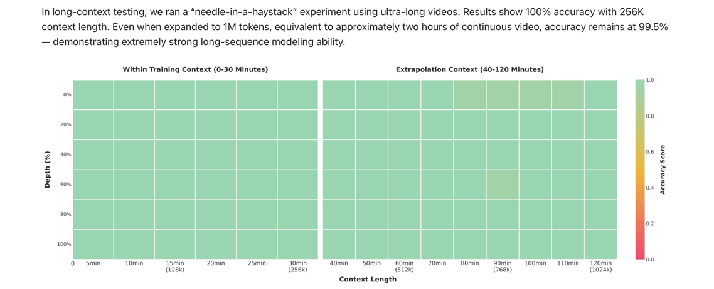

long context testing 신기하긴 하다.

## overall 

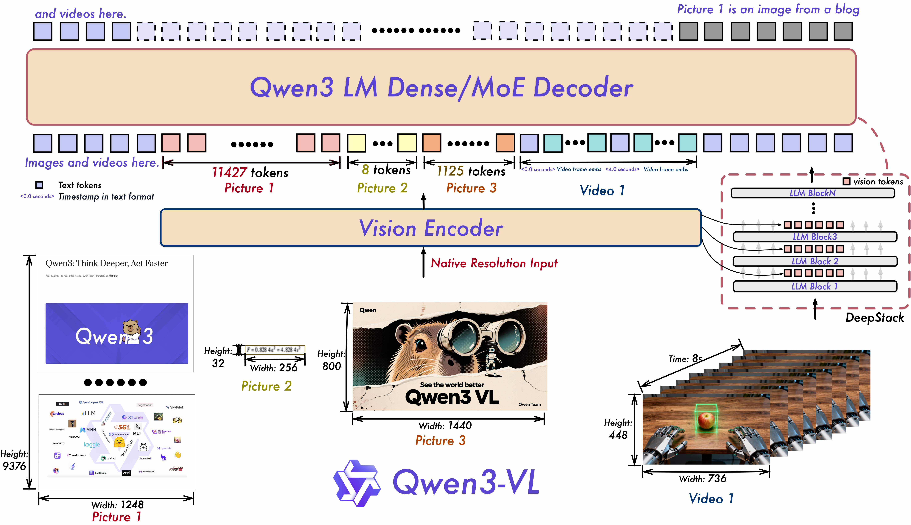

## features

### Interleaved-MRoPE 
기존 MRoPE는 time, height, width 로 dimension을 나눴었다. 

qwen2.5-VL 에서는 1초 간격으로 샘플링한 프레임과 5초 간격으로 샘플링한 프레임이 있다면 시간 간격이 위치 ID에도 반영되도록 했었다. 

0,1,2,3 처럼 늘어나는 t,h,w 가진 image patch 있고 

0, 5, 10 처럼 늘어나는 t,h,w 가진 image patch 있는셈 

근데 기존 MRoPE에는 long-video understanding의 효력을 낮추는 문제가 존재했다. 

frequency spectrum이 imbalance해지기 때문이었다.

여기서 말하는 frequency는 angular frequency를 말하는거다. 

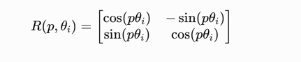

일반적인 RoPE기준으로 토큰의 위치 p가 달라지면 회전 각도가 달라지는데, angular frequency가높으면 더 많이 회전하는것. 

MRoPE에서는 각 차원별로 각각 rotation을 적용한다 

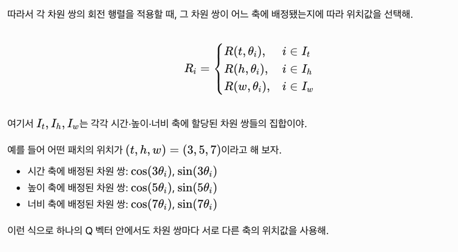

시간축은 시간축대로 회전, 등등 

근데 문제는 시간축이 고주파 영역으로만 나오고 그러면 가까운 프레임의 시간 차이를 세밀하게 표현하는데 유리하지만, 저주파에서 알 수 있는 멀리 떨어진 프레임 사이의 장거리 관계를 표현하는데 부족하다. 

#### angular frequency가 어떻게 정해지길래? 

angular frequency는 몇번째 차원이냐에 따라서 서로 다른 세타 값을 갖도록 미리 정해진 주파수 배열을 사용한다. 

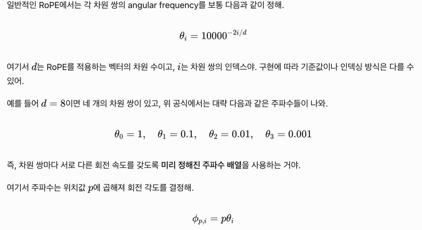

>왜 여러 주파수가 필요할까?
시계에 비유하면 이해하기 쉬워.
초침: 빠르게 움직여 짧은 시간 차이를 구분해.
분침: 더 느리게 움직여 긴 시간 간격을 나타내.
시침: 훨씬 느리게 움직여 장시간의 흐름을 표현해.

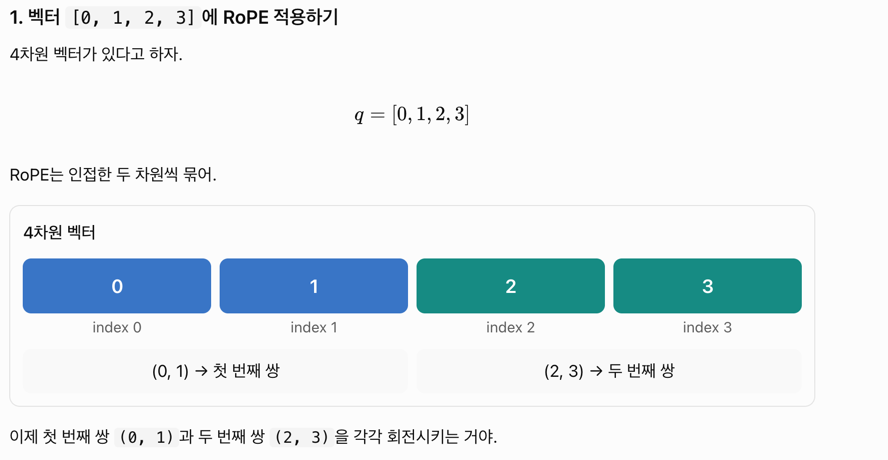

그러면 우리 실제 토큰이라고 생각하고, 256차원 벡터라고 해보자. [0,1,2,3,4...]

그러면 128 pair가 있는데 

0~42번째 pair는 시간축으로 회전을 시키게 하고, 43~84번째 pair는 높이축으로 회전을 시키게 하고, 85~128번째 pair는 width 축으로 회전을 시키게 했다.

근데 회전 주파수가 단순히 `세타 = 10000^(-2i/d)` 같은 공식이니까, 시간축은 항상 고주파 대역에 회전되는 문제가 발생했다. 

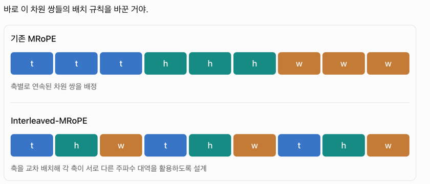

근데 이렇게 나누면 

고주파의 혜택을 t h w 가 갖고, 저주파도 나눠서 갖게 된다. 

기존 MRoPE: 시간·높이·너비가 서로 다른 주파수 구간을 담당

Interleaved-MRoPE: 각 축에 여러 주파수 대역을 교차 배분

따라서 시간 축이 다양한 속도의 회전을 활용할 수 있게 돼. 빠르게 변하는 시간적 관계뿐 아니라 느리게 변하는 장거리 시간적 관계도 표현할 수 있도록 설계한 거지.

### text timestamp 넣기 

원래 qwen2.5 에서는 토큰마다 Id로 시간을 표현하려고 했다. t=1, t=2, ... 이게 실제시간 0.5초마다 1씩 증가 이런식으로 

긴 영상이 되면 2시간째에는 t=14,400인데 1초당 1프레임이면 쓸모있는값은 홀수뿐. 너무 sparse하게 표현된다. 

그래서 `<3.0 second><토큰임베딩>` 이런식으로 시간을 전달하면, 언어모델의 능력으로 시간을 처리하게 되고, 컨텍스트 토큰을 조금 더 쓰게되지만, video grounding 같은데에 (비디오에서 무슨일 일어났는지 표현) 도움 된다. 

### DeepStack 설명 

ViT (visual Transformer) 가 이미지에서 추출한 정보를 LLM 한 지점에만 전달하지 않고 여러층에 나눠서 전달한다. 

이제 위치정보는 mRoPE 통해서 초반쪽에 주입될건데, 이번에는 이미지를 처리한 임베딩 토큰 자체를 ViT의 여러 레이어에서 만들고, LLM의 각 층에 넣자는 말이다. 

기존엔 ViT에서 이미지 임베딩 토큰이 하나 나오고 위치정보랑함께 LLM의 입력으로 들어갔다.  

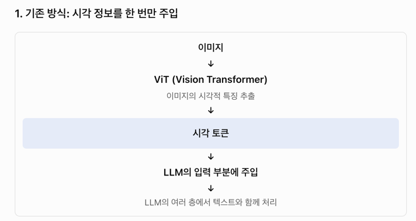

그런데, 이러면 LLM의 깊은 층으로 전달되면서 세밀한 시각 정보가 충분히 보존되지 않을 수가 있다. 

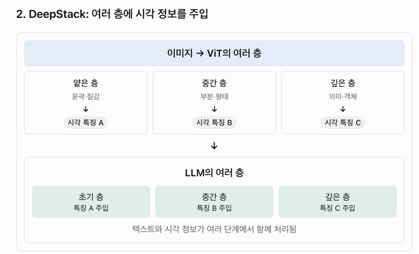

이렇게하면, 

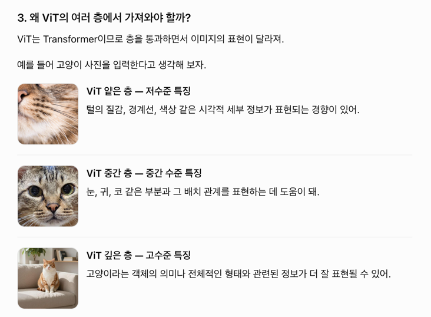

텍스트를 단어별로 나누듯이, 이미지도 특징별로 나눠서 정보를 전달할 수 있게 됨

LLM도 lost in the middle 같은 특성이 있었는데 (중간내용을 까먹음)

이미지도 이렇게 접근하자는 것. 

residual connection이 

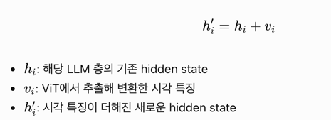

이렇게 hidden state에 이미지 토큰을 그대로 더하는 방식 
