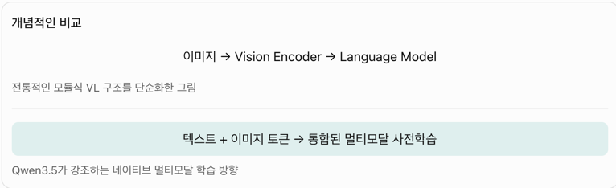

https://qwen.ai/blog?email_hash=23463b99b62a72f26ed677cc556c44e8&id=qwen3.5

gpt5.2 , claude 4.5 Opus 에 비견되는 모델이다. 이미 다른애들도 멀티모달임 

## 이제는 더이상 물러날 곳이 없다

qwen3.5 부터는 qwen3.5 -vl 모델을 따로 내지 않는다. 이미 모델자체가 멀티모달이다.

vision과 language component 트레이닝을 한방에 처리하는것보다 각각 진행하는 heterogeneous infrastructure을 가져서, 효율성을 갖춘다 
 - cross-component 간 sparse activation 시켜서 (이미지 처리할땐 이미지, 오디오 처리할 땐 오디오 쪽의 activation만 일어남) 순수 텍스트 학습 vs 텍스트-이미지-비디오 학습 throughput이 비슷했다.
 - 오차가 민감한 레이어에서는 BF16 (Floating point 16) 유지하고, 아래 세 연산은 FP8로 진행  
   - 각 레이어에서 계산되는 중간 텐서 - activations 
   - 어떤 전문가에게 보낼지 결정 - MoE routing 
   - 행렬곱셈연산 -계산량과 메모리 트래픽 감소 

framework-induced interruptions 없이고 agentic workflow를 지원해서, multi-turn interaction을 지원한다. 

## 특별한 기능들 
- multimodal reasoning 하는 중에 code interpreter나 image 검색 같은 툴을 사용할 수 있다.
  - image 해석만 하는게 아니라, 이미지를 변환할 수도 있고, 중간 생각들을 렌더링하고, 이미지를 통해 최종 결과 확인할 수 있음. 

## 구조적 변경 1. Early Fusion



qwen3-vl 까지는 이미지를 visual encoder에 통과시킨 다음에야 텍스트 - 이미지토큰 - 텍스트 이런식으로 attention에 넣었음 

Qwen3 언어모델은 텍스트 기반 데이터로 사전학습된 상태에서, visual encoder 추가한 다음 추가적으로 이미지 텍스트 통합 데이터로 훈련시킴 

Qwen3.5 네이티브 멀티모달 기반 모델 학습은 

1. 텍스트, 이미지, 영상 토큰을 함께 포함한 사전학습 데이터 
2. 언어정보, 시각정보 모두 학습하는 모델 구축 
3. 멀티모달 추론, 에이전트 후속 학습 

이제 멀티모달로 하는 추론능력, 에이전틱한 능력을 더 학습시키기 시작함. 


## 구조적 변경 2. Visual Agent 

VLM: 저 버튼을 누른다고 설명 

Visual Agent: 실제로 버튼을 누르고, 결과 화면을 다시 확인하고, 다음 행동을 결정해야 한다.

학습해야하는건 3가지 

1. 시각적 UI 데이터랑 그에 따른 행동 데이터 
2. 다단계 작업 학습 : 

```
예를 들어 “문서에서 표를 찾아 수정하고 저장해”라는 작업은 여러 단계로 구성돼.
1. 문서 열기
2. 표 위치 찾기
3. 셀 수정하기
4. 수정 결과 확인하기
5. 저장하기
```
작업의 진행 상태를 유지해야함 

3. 강화학습과 실행 환경 프레임워크 

- 모델이 화면을 보고 행동 선택 
- 실행 환경이 실제 결과 반환 
- 작업 성공 여부 및 다른 보상신호 평가 
- 위 평가 피드백으로 더 나은 행동을 학습


## 미래에 qwen 

현재는 universal digital agent를 hybrid architecture와 native multimodal reasoning을 통해 지원한다. 

model scaling보다는 system integration을향해 진보시키는걸 생각하고 있다. 

각 세션별로 persistent memory를 가져서 에이전트끼리 이야기할 수 있는 아키텍쳐 

real-world interaction을 위한 물리적 인터페이스 갖추기 (로봇과 상호작용 등 할 수 있는 AI)

스스로 향상시키는 메커니즘 

경제적으로 운용할 수 있게 하기


